# 🗄️ DOKUMENTASI LENGKAP SKEMA DATABASE & RELASI TABEL
## Sistem Kasir (Point of Sale) & Retail Management Minimarket Koperasi PT Indo Lampung Perkasa (ILP POS)

---

### 📌 Ringkasan Eksekutif Basis Data

| Parameter | Spesifikasi Teknis |
|---|---|
| **Database Engine** | **PostgreSQL 16+** (Production/Staging) & **SQLite 3** (Testing/Local Dev) |
| **Framework ORM** | **Eloquent ORM** (Laravel 13.x / PHP 8.3+) |
| **Total Tabel Terdaftar** | **55 Tabel** (47 Tabel Aplikasi Domain + 8 Tabel Sistem Framework Laravel) |
| **Total Model Eloquent** | **42 Model** di namespace `App\Models` |
| **Indexing Khusus** | High-performance pattern indexing (`varchar_pattern_ops`) untuk SKU, Barcode, Nama Produk, dan Multi-branch Transaksi |
| **Tanggal Dokumentasi** | **15 November 2026** |

---

## 📑 DAFTAR ISI

1. [Peta Arsitektur & Diagram ERD Global](#1-peta-arsitektur--diagram-erd-global)
2. [Kluster 1: Autentikasi, Hak Akses & Konfigurasi Sistem](#kluster-1-autentikasi-hak-akses--konfigurasi-sistem)
3. [Kluster 2: POS Frontline, Sesi Kasir & Transaksi Penjualan](#kluster-2-pos-frontline-sesi-kasir--transaksi-penjualan)
4. [Kluster 3: Anggota Koperasi, Plafon Kredit & Kasbon Payroll](#kluster-3-anggota-koperasi-plafon-kredit--kasbon-payroll)
5. [Kluster 4: Master Produk, Multi-Satuan & Inventaris](#kluster-4-master-produk-multi-satuan--inventaris)
6. [Kluster 5: Audit Persediaan & Stock Opname](#kluster-5-audit-persediaan--stock-opname)
7. [Kluster 6: Logistik Distribusi, Pengadaan & Penerimaan Barang](#kluster-6-logistik-distribusi-pengadaan--penerimaan-barang)
8. [Kluster 7: Siklus Retur Barang (Kasir & Toko ke DC)](#kluster-7-siklus-retur-barang-kasir--toko-ke-dc)
9. [Kluster 8: Kemitraan Konsinyasi UMKM Lokal](#kluster-8-kemitraan-konsinyasi-umkm-lokal)
10. [Kluster 9: Akuntansi Dasar, Promosi, Absensi & Kupon BBM](#kluster-9-akuntansi-dasar-promosi-absensi--kupon-bbm)
11. [Kluster 10: Tabel Sistem Framework Laravel](#kluster-10-tabel-sistem-framework-laravel)
12. [Matriks Relasi Lengkap Antar-Tabel (Cross-Reference)](#12-matriks-relasi-lengkap-antar-tabel-cross-reference)

---

## 1. Peta Arsitektur & Diagram ERD Global

Diagram berikut memetakan keterhubungan inti antar-entitas utama dalam sistem ILP POS:

```mermaid
erDiagram
    USERS ||--o{ CASHIER_SHIFTS : "membuka/menutup"
    USERS ||--o{ TRANSACTIONS : "melayani_kasir"
    USERS ||--o{ ATTENDANCES : "mencatat_kehadiran"
    USERS ||--o{ LEAVE_REQUESTS : "mengajukan_cuti"
    USERS ||--o{ STOCK_CORRECTIONS : "otorisasi_koreksi"
    USERS }o--o{ LOCATIONS : "penugasan (user_location_access)"

    LOCATIONS ||--o{ PURCHASES : "lokasi_tujuan_po"
    LOCATIONS ||--o{ STOCK_TRANSFERS : "asal_tujuan_transfer"
    LOCATIONS ||--o{ STORE_RETURN_HEADERS : "asal_tujuan_retur"

    MEMBERS ||--o{ TRANSACTIONS : "belanja_anggota"
    MEMBERS ||--o{ DEBT_MUTATIONS : "riwayat_kasbon"
    MEMBERS ||--o{ HELD_BILLS : "keranjang_tertahan"

    CASHIER_SHIFTS ||--o{ TRANSACTIONS : "mencatat_transaksi"
    CASHIER_SHIFTS ||--o{ HELD_BILLS : "antrean_shift"
    CASHIER_SHIFTS ||--o{ CASH_HANDOVER_HEADERS : "serah_terima_laci"
    CASHIER_SHIFTS ||--o{ VOID_LOGS : "log_void_shift"

    TRANSACTIONS ||--|{ TRANSACTION_ITEMS : "rincian_faktur"
    TRANSACTIONS ||--o{ DEBT_MUTATIONS : "menimbulkan_piutang"
    TRANSACTIONS ||--o{ SALES_RETURNS : "diretur"
    TRANSACTIONS ||--o{ VOID_LOGS : "pembatalan"
    TRANSACTIONS ||--o{ COUPON_REDEMPTIONS : "klaim_kupon"

    SUPPLIERS ||--o{ PRODUCTS : "pemasok_konsinyasi"
    SUPPLIERS ||--o{ PURCHASES : "supplier_po"
    SUPPLIERS ||--o{ CONSIGNMENT_SETTLEMENTS : "pembayaran_komisi"

    PRODUCTS ||--|{ TRANSACTION_ITEMS : "dijual_di"
    PRODUCTS ||--o{ PRODUCT_UNITS : "konversi_satuan"
    PRODUCTS ||--o{ PRODUCT_BARCODES : "multi_barcode"
    PRODUCTS ||--o{ STOCK_OPNAME_ITEMS : "diaudit_di"
    PRODUCTS ||--o{ GOODS_RECEIPT_ITEMS : "diterima_di"
    PRODUCTS ||--o{ STORE_RETURN_ITEMS : "diretur_toko"
    PRODUCTS ||--o{ COUPON_UNITS : "produk_voucher"

    CHART_OF_ACCOUNTS ||--o{ JOURNAL_ENTRY_LINES : "akun_pembukuan"
    JOURNAL_ENTRIES ||--|{ JOURNAL_ENTRY_LINES : "baris_jurnal"
```

---

## Kluster 1: Autentikasi, Hak Akses & Konfigurasi Sistem

### 1.1 `users`
- **Model Eloquent**: `App\Models\User`
- **Fungsi Bisnis**: Menyimpan akun seluruh staf operasional, kasir, supervisor, manager gerai, dan pemilik toko (*Owner*). Mendukung login berbasis password terenkripsi (Bcrypt), login cepat NIK kasir, dan verifikasi PIN numerik 6-digit untuk otorisasi manajerial.
- **Struktur Kolom**:

| Kolom | Tipe Data | Nullable | Default | Keterangan |
|---|---|---|---|---|
| `id` | `bigint` | Tidak | Auto-increment | Primary Key pengguna |
| `name` | `varchar` | Tidak | - | Nama lengkap staf / karyawan |
| `email` | `varchar` | Tidak | - | Alamat email unik untuk login & notifikasi |
| `email_verified_at` | `timestamp` | Ya | `NULL` | Waktu verifikasi email |
| `password` | `varchar` | Tidak | - | Password login terenkripsi hash |
| `username` | `varchar` | Ya | `NULL` | Username login unik staf |
| `nik` | `varchar` | Ya | `NULL` | Nomor Induk Karyawan PT ILP |
| `role` | `varchar` | Tidak | `'Kasir'` | Peran sistem (`Kasir`, `Supervisor`, `Manager`, `Owner`) |
| `pin` | `varchar` | Tidak | `'123456'` | PIN 6-digit untuk otorisasi void, diskon, & login |
| `branch` | `varchar` | Tidak | `'Pusat'` | Nama unit cabang penugasan utama |
| `is_active` | `boolean` | Tidak | `true` | Status keaktifan akun pengguna |
| `remember_token` | `varchar` | Ya | `NULL` | Token "Remember Me" session Laravel |
| `created_at` / `updated_at` | `timestamp` | Ya | `NULL` | Jejak audit waktu pembuatan & perubahan |

- **Relasi Database**:
  - `hasMany(CashierShift::class)`: Sesi kasir yang dibuka oleh user ini.
  - `hasMany(Transaction::class)`: Transaksi penjualan yang diproses oleh user ini.
  - `hasMany(Attendance::class)`: Log kehadiran harian user.
  - `hasMany(LeaveRequest::class)`: Permohonan cuti/izin yang diajukan user.
  - `belongsToMany(Location::class, 'user_location_access')`: Multi-cabang yang diizinkan diakses user.

---

### 1.2 `locations`
- **Model Eloquent**: `App\Models\Location`
- **Fungsi Bisnis**: Master data entitas cabang toko fisik, gudang logistik, dan unit usaha perkebunan/pabrik (Pusat, Mill / Pabrik, Kebun Barat, Kebun Timur, DC Cikarang).
- **Struktur Kolom**:

| Kolom | Tipe Data | Nullable | Default | Keterangan |
|---|---|---|---|---|
| `id` | `bigint` | Tidak | Auto-increment | Primary Key lokasi |
| `code` | `varchar` | Tidak | - | Kode unik cabang (misal: `LOC-01`, `LOC-DC`) |
| `name` | `varchar` | Tidak | - | Nama resmi cabang / gudang |
| `type` | `varchar` | Tidak | `'STORE'` | Tipe entitas (`STORE`, `WAREHOUSE`, `FACTORY`, `PLANTATION`) |
| `address` | `varchar` | Ya | `NULL` | Alamat fisik lokasi cabang |
| `manager` | `varchar` | Ya | `NULL` | Nama manager penanggung jawab |
| `manager_email` | `varchar` | Ya | `NULL` | Email kontak manager cabang |
| `phone` | `varchar` | Ya | `NULL` | Nomor telepon operasional cabang |
| `status` | `varchar` | Tidak | `'AKTIF'` | Status operasional (`AKTIF`, `MAINTENANCE`, `TUTUP`) |
| `is_active` | `boolean` | Tidak | `true` | Flag keaktifan lokasi |
| `created_at` / `updated_at` | `timestamp` | Ya | `NULL` | Timestamp |

- **Relasi Database**:
  - `belongsToMany(User::class, 'user_location_access')`: Staf yang ditugaskan di lokasi ini.
  - `hasMany(StockTransfer::class, 'from_location_id')`: Transfer barang keluar dari lokasi ini.
  - `hasMany(StockTransfer::class, 'to_location_id')`: Transfer barang masuk menuju lokasi ini.
  - `hasMany(Purchase::class, 'location_id')`: Pengadaan PO untuk lokasi ini.
  - `hasMany(StoreOperation::class, 'location_id')`: Riwayat operasional buka/tutup toko.

---

### 1.3 `user_location_access`
- **Model Eloquent**: Menggunakan relasi pivot `Location::users()` dan `User::locations()`.
- **Fungsi Bisnis**: Tabel perantara (*junction table*) yang mengatur hak otorisasi staf multi-cabang (misal: Supervisor yang berwenang di Toko Pusat dan Cabang Mill).
- **Struktur Kolom**:

| Kolom | Tipe Data | Nullable | Default | Keterangan |
|---|---|---|---|---|
| `id` | `bigint` | Tidak | Auto-increment | Primary Key pivot |
| `user_id` | `bigint` | Tidak | - | Foreign Key ke `users.id` (onDelete: cascade) |
| `location_id` | `bigint` | Tidak | - | Foreign Key ke `locations.id` (onDelete: cascade) |
| `created_at` / `updated_at` | `timestamp` | Ya | `NULL` | Timestamp |

---

### 1.4 `app_settings`
- **Model Eloquent**: `App\Models\AppSetting`
- **Fungsi Bisnis**: Konfigurasi global sistem berbasis key-value store, mencakup identitas toko koperasi, NPWP, persentase tarif PPN (11%/12%), jam operasional, dan saklar kebijakan wajib PIN Supervisor.
- **Struktur Kolom**:

| Kolom | Tipe Data | Nullable | Default | Keterangan |
|---|---|---|---|---|
| `id` | `bigint` | Tidak | Auto-increment | Primary Key setting |
| `key` | `varchar` | Tidak | - | Kunci konfigurasi unik (misal: `tax_rate`, `store_name`) |
| `value` | `text` | Ya | `NULL` | Nilai konfigurasi teks atau JSON string |
| `group` | `varchar` | Tidak | `'general'` | Pengelompokan setting (`general`, `tax`, `security`, `printer`) |
| `created_at` / `updated_at` | `timestamp` | Ya | `NULL` | Timestamp |

---

### 1.5 `audit_logs`
- **Model Eloquent**: `App\Models\AuditLog`
- **Fungsi Bisnis**: Buku log audit keamanan immutable (*tamper-evident*) yang mencatat setiap aksi strategis: perubahan data user, reset password/PIN, pengubahan limit kredit anggota, void faktur, dan penyesuaian PPN.
- **Struktur Kolom**:

| Kolom | Tipe Data | Nullable | Default | Keterangan |
|---|---|---|---|---|
| `id` | `bigint` | Tidak | Auto-increment | Primary Key log |
| `log_id` | `varchar` | Ya | `NULL` | Kode serial log (misal: `AUD-YYYYMMDD-XXXX`) |
| `user_id` | `bigint` | Ya | `NULL` | Referensi user pelaku aksi |
| `user_name` | `varchar` | Tidak | - | Nama staf saat melakukan aksi |
| `user_role` | `varchar` | Tidak | `'Owner'` | Peran staf saat itu |
| `location` | `varchar` | Tidak | `'Pusat'` | Lokasi cabang eksekusi aksi |
| `category` | `varchar` | Tidak | `'Umum'` | Kategori aksi (`Keamanan`, `Transaksi`, `Master Data`, `Perpajakan`) |
| `action_name` | `varchar` | Tidak | - | Nama aksi (misal: `UPDATE_CREDIT_LIMIT`, `VOID_TRANSACTION`) |
| `description` | `text` | Tidak | - | Penjelasan detail aksi yang dilakukan |
| `reference` | `varchar` | Ya | `NULL` | Nomor referensi dokumen terkait (misal nomor faktur / NIK) |
| `status` | `varchar` | Tidak | `'BERHASIL'` | Status eksekusi (`BERHASIL`, `GAGAL`, `DITOLAK`) |
| `source` | `varchar` | Ya | `NULL` | Sumber antarmuka (`Web Console`, `POS Terminal`, `API`) |
| `changes` | `json` | Ya | `NULL` | Snapshot data sebelum vs sesudah dalam format JSON |
| `created_at` / `updated_at` | `timestamp` | Ya | `NULL` | Timestamp |

---

### 1.6 `system_notifications`
- **Model Eloquent**: `App\Models\SystemNotification`
- **Fungsi Bisnis**: Menyimpan notifikasi terpusat untuk disalurkan ke lonceng antarmuka (*notification bell*) berdasarkan peran pengguna (peringatan stok menipis, permohonan otorisasi void, persetujuan retur, dll).
- **Struktur Kolom**:

| Kolom | Tipe Data | Nullable | Default | Keterangan |
|---|---|---|---|---|
| `id` | `bigint` | Tidak | Auto-increment | Primary Key notifikasi |
| `role` | `varchar` | Tidak | `'ALL'` | Target penerima (`ALL`, `Kasir`, `Supervisor`, `Manager`, `Owner`) |
| `title` | `varchar` | Tidak | - | Judul notifikasi |
| `message` | `text` | Tidak | - | Isi pesan detail notifikasi |
| `category` | `varchar` | Tidak | `'SYSTEM'` | Kategori (`STOCK`, `TRANSACTION`, `APPROVAL`, `SYSTEM`) |
| `icon` | `varchar` | Tidak | `'notifications'`| Nama ikon Material Symbols Rounded |
| `color` | `varchar` | Tidak | `'blue'` | Warna aksen UI (`blue`, `amber`, `emerald`, `rose`) |
| `link` | `varchar` | Ya | `NULL` | Tautan navigasi cepat halaman terkait |
| `reference_id` | `varchar` | Ya | `NULL` | Referensi ID dokumen terkait |
| `is_read` | `boolean` | Tidak | `false` | Status apakah notifikasi sudah dibaca |
| `read_at` | `timestamp` | Ya | `NULL` | Waktu notifikasi dibaca |
| `created_at` / `updated_at` | `timestamp` | Ya | `NULL` | Timestamp |

---

### 1.7 `store_operations` & `document_sequences`
- **Fungsi Bisnis**:
  - `store_operations`: Mengontrol status operasional gerai buka atau tutup sementara di suatu lokasi cabang.
  - `document_sequences`: Generator nomor dokumen berurutan (*sequential counter*) anti-tabrakan untuk faktur penjualan (`TRX-`), surat jalan (`TRF-`), tanda terima (`RCV-`), dan opname (`SOP-`).
- **Relasi**:
  - `store_operations.location_id` -> `locations.id`
  - `document_sequences.location_id` -> `locations.id`

---

## Kluster 2: POS Frontline, Sesi Kasir & Transaksi Penjualan

### 2.1 `cashier_shifts`
- **Model Eloquent**: `App\Models\CashierShift`
- **Fungsi Bisnis**: Menyimpan data sesi operasional laci kasir per shift tugas. Mengatur modal awal (*Opening Cash*), menghitung akumulasi penjualan tunai, QRIS, kasbon, mutasi kas masuk/keluar (*petty cash*), hingga rekonsiliasi uang fisik hasil *Blind Count* di akhir shift.
- **Struktur Kolom**:

| Kolom | Tipe Data | Nullable | Default | Keterangan |
|---|---|---|---|---|
| `id` | `bigint` | Tidak | Auto-increment | Primary Key sesi kasir |
| `shift_code` | `varchar` | Tidak | - | Kode unik sesi (misal: `SHF-20261115-001`) |
| `terminal_code` | `varchar` | Tidak | - | Kode terminal kasir (`Kasir 01` s/d `Kasir 12`) |
| `user_id` | `bigint` | Ya | `NULL` | Foreign Key ke `users.id` |
| `cashier_nik` | `varchar` | Tidak | - | NIK petugas kasir bertugas |
| `cashier_name` | `varchar` | Tidak | - | Nama petugas kasir bertugas |
| `opening_cash` | `numeric` | Tidak | - | Saldo modal awal di laci kasir |
| `cash_sales_total` | `numeric` | Tidak | `0` | Total penerimaan penjualan tunai |
| `qris_sales_total` | `numeric` | Tidak | `0` | Total penjualan via QRIS / EDC |
| `credit_sales_total`| `numeric` | Tidak | `0` | Total penjualan piutang kasbon anggota |
| `total_sales` | `numeric` | Tidak | `0` | Total seluruh omzet shift berjalan |
| `transaction_count` | `integer` | Tidak | `0` | Jumlah struk belanja yang berhasil diproses |
| `cash_in` | `numeric` | Tidak | `0` | Total uang masuk tambahan ke laci |
| `cash_out` | `numeric` | Tidak | `0` | Total pengeluaran kas kecil operasional |
| `expected_cash` | `numeric` | Tidak | `0` | Ekspektasi kas laci menurut kalkulasi sistem |
| `actual_cash` | `numeric` | Ya | `NULL` | Saldo fisik riil hasil hitungan kasir (denominasi) |
| `variance` | `numeric` | Ya | `NULL` | Selisih kas (`actual_cash - expected_cash`) |
| `variance_status` | `varchar` | Ya | `NULL` | Status selisih (`SESUAI`, `SELISIH_KURANG`, `SELISIH_LEBIH`) |
| `closing_notes` | `text` | Ya | `NULL` | Catatan penjelasan kasir jika terjadi selisih |
| `status` | `varchar` | Tidak | `'OPEN'` | Status sesi (`OPEN`, `CLOSED`, `HANDOVER_PENDING`) |
| `opened_at` | `timestamp` | Tidak | - | Waktu pembukaan sesi shift |
| `closed_at` | `timestamp` | Ya | `NULL` | Waktu penutupan sesi shift |
| `created_at` / `updated_at` | `timestamp` | Ya | `NULL` | Timestamp |

- **Relasi Database**:
  - `belongsTo(User::class, 'user_id')`: Akun kasir pemilik sesi.
  - `hasMany(Transaction::class, 'shift_id')`: Transaksi penjualan selama sesi ini.
  - `hasMany(HeldBill::class, 'shift_id')`: Transaksi ditahan pada sesi ini.
  - `hasMany(CashHandoverHeader::class, 'cashier_shift_id')`: Serah terima fisik kas laci.
  - `hasMany(VoidLog::class, 'shift_id')`: Pembatalan item/transaksi pada sesi ini.

---

### 2.2 `cash_handover_headers`
- **Model Eloquent**: `App\Models\CashHandoverHeader`
- **Fungsi Bisnis**: Dokumen berita acara serah terima uang fisik laci kasir, baik saat diserahkan ke kasir pengganti (*Handover*) maupun disetorkan ke brankas/supervisor (*Drop Safe*).
- **Struktur Kolom**:

| Kolom | Tipe Data | Nullable | Default | Keterangan |
|---|---|---|---|---|
| `id` | `bigint` | Tidak | Auto-increment | Primary Key serah terima |
| `handover_number` | `varchar` | Tidak | - | Nomor dokumen serah terima |
| `cashier_shift_id` | `bigint` | Ya | `NULL` | Foreign Key ke `cashier_shifts.id` |
| `received_by` | `bigint` | Ya | `NULL` | Foreign Key ke `users.id` (penerima kas) |
| `handover_at` | `timestamp` | Tidak | - | Waktu serah terima kas |
| `total_amount` | `numeric` | Tidak | `0` | Total nominal uang fisik yang diserahterimakan |
| `status` | `varchar` | Tidak | `'CONFIRMED'` | Status serah terima (`CONFIRMED`, `PENDING`) |
| `created_at` / `updated_at` | `timestamp` | Ya | `NULL` | Timestamp |

- **Relasi Database**:
  - `belongsTo(CashierShift::class, 'cashier_shift_id')`
  - `belongsTo(User::class, 'received_by')`

---

### 2.3 `transactions`
- **Model Eloquent**: `App\Models\Transaction`
- **Fungsi Bisnis**: Menyimpan dokumen induk transaksi penjualan (*Sales Invoice*). Menampung kalkulasi subtotal, diskon kupon, diskon clearance expired, pajak PPN 11%, dan pembayaran campuran (*split payment*).
- **Struktur Kolom**:

| Kolom | Tipe Data | Nullable | Default | Keterangan |
|---|---|---|---|---|
| `id` | `bigint` | Tidak | Auto-increment | Primary Key transaksi |
| `invoice_number` | `varchar` | Tidak | - | Nomor faktur belanja unik (misal: `TRX-20261115-0001`) |
| `shift_id` | `bigint` | Tidak | - | Foreign Key ke `cashier_shifts.id` |
| `user_id` | `bigint` | Ya | `NULL` | Foreign Key ke `users.id` (petugas kasir) |
| `cashier_name` | `varchar` | Tidak | - | Nama kasir yang memproses checkout |
| `terminal_code` | `varchar` | Tidak | - | Kode terminal kasir saat transaksi |
| `member_id` | `bigint` | Ya | `NULL` | Foreign Key ke `members.id` (jika pelanggan anggota) |
| `member_nik` | `varchar` | Ya | `NULL` | NIK anggota pembeli |
| `member_name` | `varchar` | Ya | `NULL` | Nama anggota pembeli |
| `payment_method` | `varchar` | Tidak | - | Metode bayar (`cash`, `qris`, `debit`, `credit`, `campuran`) |
| `subtotal` | `numeric` | Tidak | - | Nilai kotor belanja sebelum diskon & pajak |
| `discount_total` | `numeric` | Tidak | `0` | Total potongan harga (promo, kupon, expired) |
| `tax_total` | `numeric` | Tidak | `0` | Total nilai PPN 11% yang dikenakan |
| `grand_total` | `numeric` | Tidak | - | Total akhir yang wajib dibayarkan pelanggan |
| `cash_received` | `numeric` | Tidak | `0` | Jumlah uang tunai yang diserahkan pelanggan |
| `change_returned` | `numeric` | Tidak | `0` | Uang kembalian yang diberikan ke pelanggan |
| `payment_reference`| `varchar` | Ya | `NULL` | Nomor referensi approval QRIS/EDC |
| `split_cash` | `numeric` | Tidak | `0` | Porsi nominal tunai pada metode bayar campuran |
| `split_non_cash` | `numeric` | Tidak | `0` | Porsi nominal non-tunai pada metode campuran |
| `status` | `varchar` | Tidak | `'SUCCESS'` | Status faktur (`SUCCESS`, `VOIDED`, `PENDING`) |
| `voided_at` | `timestamp` | Ya | `NULL` | Waktu transaksi dibatalkan (jika void) |
| `voided_by` | `varchar` | Ya | `NULL` | Nama supervisor yang menyetujui void |
| `void_reason` | `text` | Ya | `NULL` | Alasan pembatalan transaksi |
| `created_at` / `updated_at` | `timestamp` | Ya | `NULL` | Timestamp |

- **Relasi Database**:
  - `belongsTo(CashierShift::class, 'shift_id')`
  - `belongsTo(User::class, 'user_id')`
  - `belongsTo(Member::class, 'member_id')`
  - `hasMany(TransactionItem::class, 'transaction_id')`: Rincian barang belanjaan.
  - `hasMany(DebtMutation::class, 'transaction_id')`: Mutasi piutang jika bayar kasbon.
  - `hasMany(VoidLog::class, 'transaction_id')`: Catatan log void.
  - `hasMany(SalesReturn::class, 'transaction_id')`: Pengembalian retur faktur ini.
  - `hasMany(CouponRedemption::class, 'transaction_id')`: Kupon yang ditukarkan.

---

### 2.4 `transaction_items`
- **Model Eloquent**: `App\Models\TransactionItem`
- **Fungsi Bisnis**: Mencatat rincian setiap baris produk yang dibeli dalam satu faktur transaksi, kuantitas, harga satuan, HPP untuk kalkulasi laba rugi, dan kalkulasi diskon otomatis produk mendekati expired.
- **Struktur Kolom**:

| Kolom | Tipe Data | Nullable | Default | Keterangan |
|---|---|---|---|---|
| `id` | `bigint` | Tidak | Auto-increment | Primary Key item |
| `transaction_id` | `bigint` | Tidak | - | Foreign Key ke `transactions.id` (onDelete: cascade) |
| `product_id` | `bigint` | Tidak | - | Foreign Key ke `products.id` |
| `sku` | `varchar` | Tidak | - | Kode SKU barang saat transaksi |
| `barcode` | `varchar` | Tidak | - | Barcode barang saat transaksi |
| `product_name` | `varchar` | Tidak | - | Nama produk saat transaksi |
| `unit` | `varchar` | Tidak | `'Pcs'` | Satuan kuantitas produk |
| `unit_price` | `numeric` | Tidak | - | Harga jual satuan |
| `qty` | `integer` | Tidak | - | Kuantitas jumlah barang yang dibeli |
| `is_taxable` | `boolean` | Tidak | `true` | Apakah item ini dikenakan PPN |
| `tax_amount` | `numeric` | Tidak | `0` | Nilai pajak item |
| `is_expired_clearance` | `boolean` | Tidak | `false` | Apakah mendapatkan diskon otomatis expired |
| `clearance_discount_percent`| `numeric` | Tidak | `0` | Persentase diskon expired (10% atau 25%) |
| `discount_amount`| `numeric` | Tidak | `0` | Total potongan nominal diskon item |
| `total_price` | `numeric` | Tidak | - | Total bersih item (`(qty * price) - discount`) |
| `created_at` / `updated_at` | `timestamp` | Ya | `NULL` | Timestamp |

- **Relasi Database**:
  - `belongsTo(Transaction::class, 'transaction_id')`
  - `belongsTo(Product::class, 'product_id')`

---

### 2.5 `held_bills`
- **Model Eloquent**: `App\Models\HeldBill`
- **Fungsi Bisnis**: Menyimpan draf antrean transaksi belanja yang ditangguhkan sementara (*Hold Bill*) ketika pelanggan sedang mengambil barang tambahan, sehingga kasir dapat melayani pelanggan berikutnya tanpa menghilangkan keranjang belanja.
- **Struktur Kolom**:

| Kolom | Tipe Data | Nullable | Default | Keterangan |
|---|---|---|---|---|
| `id` | `bigint` | Tidak | Auto-increment | Primary Key hold bill |
| `hold_code` | `varchar` | Tidak | - | Nomor antrean hold (misal: `HLD-001`) |
| `shift_id` | `bigint` | Tidak | - | Foreign Key ke `cashier_shifts.id` |
| `terminal_code` | `varchar` | Tidak | - | Kode terminal kasir |
| `customer_name` | `varchar` | Tidak | - | Nama pelanggan / keterangan antrean |
| `member_id` | `bigint` | Ya | `NULL` | Foreign Key ke `members.id` (jika teridentifikasi) |
| `member_nik` | `varchar` | Ya | `NULL` | NIK anggota |
| `items_payload` | `json` | Tidak | - | Payload array seluruh item belanja dalam format JSON |
| `subtotal` | `numeric` | Tidak | `0` | Estimasi subtotal belanja |
| `tax_total` | `numeric` | Tidak | `0` | Estimasi pajak PPN |
| `grand_total` | `numeric` | Tidak | - | Estimasi grand total |
| `total_items` | `integer` | Tidak | - | Jumlah item dalam keranjang tertahan |
| `note` | `varchar` | Ya | `NULL` | Alasan atau catatan penahanan nota |
| `status` | `varchar` | Tidak | `'HELD'` | Status (`HELD`, `RECALLED`, `CANCELLED`) |
| `held_at` | `timestamp` | Tidak | - | Waktu nota ditahan |
| `recalled_at` | `timestamp` | Ya | `NULL` | Waktu nota dipanggil kembali ke kasir |
| `created_at` / `updated_at` | `timestamp` | Ya | `NULL` | Timestamp |

- **Relasi Database**:
  - `belongsTo(CashierShift::class, 'shift_id')`
  - `belongsTo(Member::class, 'member_id')`

---

### 2.6 `void_logs`
- **Model Eloquent**: `App\Models\VoidLog`
- **Fungsi Bisnis**: Log pengawasan anti-fraud yang mencatat setiap aksi pembatalan transaksi utuh (*Void Bill*) maupun pembatalan baris barang (*Void Item*) beserta identitas Supervisor yang mengotorisasi via PIN.
- **Struktur Kolom**:

| Kolom | Tipe Data | Nullable | Default | Keterangan |
|---|---|---|---|---|
| `id` | `bigint` | Tidak | Auto-increment | Primary Key log void |
| `transaction_id` | `bigint` | Ya | `NULL` | Foreign Key ke `transactions.id` |
| `shift_id` | `bigint` | Ya | `NULL` | Foreign Key ke `cashier_shifts.id` |
| `action_type` | `varchar` | Tidak | - | Tipe aksi (`VOID_ITEM`, `VOID_TRANSACTION`) |
| `supervisor_nik` | `varchar` | Tidak | - | NIK Supervisor yang mengotorisasi |
| `supervisor_name`| `varchar` | Tidak | - | Nama Supervisor yang mengotorisasi |
| `cashier_name` | `varchar` | Tidak | - | Nama kasir yang mengajukan |
| `item_sku` | `varchar` | Ya | `NULL` | SKU barang yang dibatalkan (jika void item) |
| `item_name` | `varchar` | Ya | `NULL` | Nama barang yang dibatalkan |
| `item_qty` | `integer` | Ya | `NULL` | Kuantitas barang yang dibatalkan |
| `amount_voided` | `numeric` | Tidak | `0` | Nominal rupiah yang dibatalkan |
| `reason` | `text` | Tidak | - | Alasan pembatalan yang diinput |
| `ip_address` | `varchar` | Ya | `NULL` | IP address terminal kasir |
| `created_at` / `updated_at` | `timestamp` | Ya | `NULL` | Timestamp |

- **Relasi Database**:
  - `belongsTo(Transaction::class, 'transaction_id')`
  - `belongsTo(CashierShift::class, 'shift_id')`

---

## Kluster 3: Anggota Koperasi, Plafon Kredit & Kasbon Payroll

### 3.1 `members`
- **Model Eloquent**: `App\Models\Member`
- **Fungsi Bisnis**: Master data anggota koperasi karyawan PT Indo Lampung Perkasa dari berbagai unit kerja (Pabrik / Mill, Kebun Barat, Kebun Timur). Menyimpan batas plafon kredit belanja bulanan (*credit limit*) dan saldo akumulasi kasbon berjalan (*current debt*).
- **Struktur Kolom**:

| Kolom | Tipe Data | Nullable | Default | Keterangan |
|---|---|---|---|---|
| `id` | `bigint` | Tidak | Auto-increment | Primary Key anggota |
| `member_code` | `varchar` | Tidak | - | Nomor kartu / ID unik anggota |
| `nik` | `varchar` | Tidak | - | NIK Karyawan resmi PT ILP (unik) |
| `name` | `varchar` | Tidak | - | Nama lengkap anggota |
| `department` | `varchar` | Ya | `NULL` | Departemen kerja (Mill, Kebun, Workshop, HRD) |
| `branch` | `varchar` | Tidak | `'Cabang 1 - Mill / Pabrik'` | Cabang pendaftaran anggota |
| `phone` | `varchar` | Ya | `NULL` | Nomor kontak telepon anggota |
| `credit_limit` | `numeric` | Tidak | `0` | Plafon batas maksimal kasbon belanja |
| `current_debt` | `numeric` | Tidak | `0` | Saldo piutang belanja berjalan saat ini |
| `status` | `varchar` | Tidak | `'AKTIF'` | Status keanggotaan (`AKTIF`, `DIBEKUKAN`, `NONAKTIF`) |
| `join_date` | `date` | Ya | `NULL` | Tanggal resmi bergabung dengan koperasi |
| `notes` | `text` | Ya | `NULL` | Catatan administratif |
| `created_at` / `updated_at` | `timestamp` | Ya | `NULL` | Timestamp |

- **Relasi Database**:
  - `hasMany(Transaction::class, 'member_id')`: Riwayat transaksi belanja anggota.
  - `hasMany(DebtMutation::class, 'member_id')`: Seluruh riwayat mutasi kasbon & pembayaran.
  - `hasMany(HeldBill::class, 'member_id')`: Antrean tertahan atas nama anggota ini.

---

### 3.2 `debt_mutations`
- **Model Eloquent**: `App\Models\DebtMutation`
- **Fungsi Bisnis**: Buku besar mutasi piutang kasbon karyawan. Setiap kali anggota berbelanja tempo di kasir, melakukan pembayaran di kasir, atau dipotong gaji massal via payroll HRD, saldo dicatat secara transparan dengan audit trail saldo sebelum dan sesudah.
- **Struktur Kolom**:

| Kolom | Tipe Data | Nullable | Default | Keterangan |
|---|---|---|---|---|
| `id` | `bigint` | Tidak | Auto-increment | Primary Key mutasi |
| `member_id` | `bigint` | Tidak | - | Foreign Key ke `members.id` (onDelete: cascade) |
| `member_nik` | `varchar` | Tidak | - | NIK karyawan anggota |
| `transaction_id` | `bigint` | Ya | `NULL` | Foreign Key ke `transactions.id` (jika dari kasir) |
| `invoice_number` | `varchar` | Ya | `NULL` | Nomor invoice belanja |
| `branch` | `varchar` | Tidak | - | Cabang terjadinya mutasi kasbon |
| `mutation_type` | `varchar` | Tidak | - | Tipe mutasi (`KASBON_BELANJA`, `PEMBAYARAN_KASIR`, `POTONG_GAJI_PAYROLL`, `PENYESUAIAN`) |
| `amount` | `numeric` | Tidak | - | Nominal mutasi rupiah |
| `previous_debt` | `numeric` | Tidak | - | Saldo hutang sebelum mutasi |
| `new_debt` | `numeric` | Tidak | - | Saldo hutang setelah mutasi |
| `previous_limit`| `numeric` | Tidak | - | Sisa plafon sebelum mutasi |
| `new_limit` | `numeric` | Tidak | - | Sisa plafon setelah mutasi |
| `notes` | `text` | Ya | `NULL` | Catatan transaksi mutasi |
| `processed_by` | `varchar` | Ya | `NULL` | Staf atau sistem yang memproses mutasi |
| `created_at` / `updated_at` | `timestamp` | Ya | `NULL` | Timestamp |

- **Relasi Database**:
  - `belongsTo(Member::class, 'member_id')`
  - `belongsTo(Transaction::class, 'transaction_id')`

---

## Kluster 4: Master Produk, Multi-Satuan & Inventaris

### 4.1 `products`
- **Model Eloquent**: `App\Models\Product`
- **Fungsi Bisnis**: Master data seluruh barang dagangan retail dan titip jual UMKM. Menampung data SKU, barcode, HPP (*cost price*), harga umum, harga khusus anggota koperasi, saldo stok fisik, status kadaluwarsa, dan bendera konsinyasi.
- **Struktur Kolom**:

| Kolom | Tipe Data | Nullable | Default | Keterangan |
|---|---|---|---|---|
| `id` | `bigint` | Tidak | Auto-increment | Primary Key produk |
| `sku` | `varchar` | Tidak | - | Kode unik SKU (misal: `SKU-MN-001`) |
| `barcode` | `varchar` | Tidak | - | Kode barcode fisik produk |
| `name` | `varchar` | Tidak | - | Nama barang lengkap |
| `category` | `varchar` | Tidak | `'Umum'` | Kategori produk |
| `unit` | `varchar` | Tidak | `'Pcs'` | Satuan dasar terkecil |
| `cost_price` | `numeric` | Tidak | `0` | Harga Pokok Pembelian (HPP modal) |
| `price` | `numeric` | Tidak | - | Harga jual eceran umum |
| `member_price` | `numeric` | Ya | `NULL` | Harga spesial untuk anggota koperasi |
| `stock` | `integer` | Tidak | - | Saldo stok fisik di toko |
| `min_stock` | `integer` | Tidak | `5` | Batas stok minimum untuk memicu alert restock |
| `is_taxable` | `boolean` | Tidak | `true` | Apakah kena PPN 11% saat checkout |
| `tax_rate` | `numeric` | Tidak | `11` | Persentase tarif PPN |
| `expired_date` | `date` | Ya | `NULL` | Tanggal kadaluarsa produk |
| `clearance_discount_percent`| `numeric`| Tidak | `20` | Persentase diskon clearance barang expired |
| `status` | `varchar` | Tidak | `'TERSEDIA'` | Status stok (`TERSEDIA`, `MENIPIS`, `HABIS`) |
| `is_consignment` | `boolean` | Tidak | `false` | Apakah barang titipan konsinyasi UMKM |
| `supplier_id` | `bigint` | Ya | `NULL` | Foreign Key ke `suppliers.id` jika konsinyasi |
| `commission_percent`| `numeric` | Tidak | `0` | Persentase komisi bagi hasil koperasi |
| `rack_location` | `varchar` | Ya | `NULL` | Posisi rak/lorong display barang |
| `created_at` / `updated_at` | `timestamp` | Ya | `NULL` | Timestamp |

- **Relasi Database**:
  - `belongsTo(Supplier::class, 'supplier_id')`
  - `hasMany(ProductUnit::class, 'product_id')`: Konversi multi-satuan (Dus/Pak/Pcs).
  - `hasMany(ProductBarcode::class, 'product_id')`: Multi-barcode scanner.
  - `hasMany(TransactionItem::class, 'product_id')`: Riwayat transaksi penjualan item ini.
  - `hasMany(StockOpnameItem::class, 'product_id')`: Riwayat audit stok opname.
  - `hasMany(GoodsReceiptItem::class, 'product_id')`: Penerimaan barang dari DC/supplier.
  - `hasMany(StockTransferItem::class, 'product_id')`: Pengiriman mutasi transfer stok.
  - `hasMany(StoreReturnItem::class, 'product_id')`: Retur barang dari toko ke gudang.
  - `hasMany(StockCorrection::class, 'product_id')`: Koreksi stok harian.
  - `hasMany(CouponUnit::class, 'product_id')`: Unit kupon voucher BBM terkait.

---

### 4.2 `product_units`
- **Model Eloquent**: `App\Models\ProductUnit`
- **Fungsi Bisnis**: Mendukung multi-satuan berjenjang pada barang dagangan (contoh: 1 Karton = 12 Pack = 48 Pcs). Masing-masing satuan dapat memiliki barcode sendiri dan harga khusus.
- **Struktur Kolom**:

| Kolom | Tipe Data | Nullable | Default | Keterangan |
|---|---|---|---|---|
| `id` | `bigint` | Tidak | Auto-increment | Primary Key satuan |
| `product_id` | `bigint` | Tidak | - | Foreign Key ke `products.id` (onDelete: cascade) |
| `unit_name` | `varchar` | Tidak | - | Nama satuan (misal: `Dus`, `Pack`, `Renceng`) |
| `conversion_factor`| `integer` | Tidak | - | Faktor pengali ke satuan dasar (misal: 24) |
| `barcode` | `varchar` | Ya | `NULL` | Barcode khusus kemasan multi-satuan |
| `price` | `numeric` | Tidak | - | Harga jual per kemasan satuan ini |
| `member_price` | `numeric` | Ya | `NULL` | Harga anggota khusus satuan ini |
| `is_base_unit` | `boolean` | Tidak | `false` | Apakah satuan ini adalah satuan dasar |
| `created_at` / `updated_at` | `timestamp` | Ya | `NULL` | Timestamp |

- **Relasi Database**:
  - `belongsTo(Product::class, 'product_id')`

---

### 4.3 `product_barcodes`, `product_categories`, `units`
- **Fungsi Bisnis**:
  - `product_barcodes`: Mendukung satu produk memiliki lebih dari 1 barcode fisik scanner.
  - `product_categories`: Master kategori barang dagangan.
  - `units`: Master nama dan simbol satuan standar (Pcs, Box, Dus, Botol, Pouch, dll).
- **Relasi**:
  - `product_barcodes.product_id` -> `products.id`

---

### 4.4 `stock_corrections`
- **Model Eloquent**: `App\Models\StockCorrection`
- **Fungsi Bisnis**: Pencatatan penyesuaian stok harian oleh Supervisor di luar jadwal stock opname resmi, akibat barang rusak, pecah di toko, tumpah, kemasan bocor, atau ditemukan kembali.
- **Struktur Kolom**:

| Kolom | Tipe Data | Nullable | Default | Keterangan |
|---|---|---|---|---|
| `id` | `bigint` | Tidak | Auto-increment | Primary Key koreksi |
| `correction_code`| `varchar` | Tidak | - | Kode unik koreksi (misal: `ADJ-20261115-001`) |
| `product_id` | `bigint` | Tidak | - | Foreign Key ke `products.id` |
| `branch` | `varchar` | Tidak | `'Pusat'` | Cabang terjadinya koreksi stok |
| `type` | `varchar` | Tidak | `'SUBTRACT'` | Jenis koreksi (`SUBTRACT` / `ADD`) |
| `qty` | `integer` | Tidak | - | Kuantitas jumlah yang dikoreksi |
| `stock_before` | `integer` | Tidak | - | Saldo stok sistem sebelum koreksi |
| `stock_after` | `integer` | Tidak | - | Saldo stok sistem setelah koreksi |
| `reason` | `varchar` | Tidak | - | Alasan (`KEMASAN_RUSAK`, `EXPIRED`, `HILANG`, `SELISIH_HITUNG`) |
| `user_id` | `bigint` | Ya | `NULL` | Foreign Key ke `users.id` (supervisor pengesah) |
| `supervisor_name`| `varchar`| Tidak | - | Nama supervisor yang mengesahkan |
| `notes` | `text` | Ya | `NULL` | Catatan kronologi kejadian |
| `created_at` / `updated_at` | `timestamp` | Ya | `NULL` | Timestamp |

- **Relasi Database**:
  - `belongsTo(Product::class, 'product_id')`
  - `belongsTo(User::class, 'user_id')`

---

## Kluster 5: Audit Persediaan & Stock Opname

### 5.1 `stock_opnames`
- **Model Eloquent**: `App\Models\StockOpname`
- **Fungsi Bisnis**: Dokumen header pelaksanaan audit fisik persediaan (*Stock Opname*) berkala toko, mencatat lorong rak yang diaudit, auditor petugas kasir, peninjau manager, serta ringkasan total nilai varians kerugian/kelebihan stok.
- **Struktur Kolom**:

| Kolom | Tipe Data | Nullable | Default | Keterangan |
|---|---|---|---|---|
| `id` | `bigint` | Tidak | Auto-increment | Primary Key sesi opname |
| `opname_code` | `varchar` | Tidak | - | Nomor dokumen opname (`SOP-YYYYMMDD-XXXX`) |
| `title` | `varchar` | Tidak | - | Judul/zona opname (misal: "Opname Lorong Makanan Ringan") |
| `branch` | `varchar` | Tidak | `'Pusat'` | Cabang pelaksanaan opname |
| `conducted_by` | `varchar` | Tidak | - | Nama staf pelaksana audit fisik |
| `status` | `varchar` | Tidak | `'DRAFT'` | Status (`DRAFT`, `IN_PROGRESS`, `COMPLETED`, `CANCELLED`) |
| `total_items_audited`| `integer`| Tidak | `0` | Total jenis barang yang dihitung |
| `total_items_variance`| `integer`| Tidak | `0` | Total jenis barang yang mengalami selisih |
| `total_variance_value`| `numeric`| Tidak | `0` | Total nominal nilai selisih kerugian/kelebihan |
| `notes` | `text` | Ya | `NULL` | Catatan umum audit opname |
| `completed_at` | `timestamp` | Ya | `NULL` | Waktu persetujuan penyelesaian opname oleh manager |
| `created_at` / `updated_at` | `timestamp` | Ya | `NULL` | Timestamp |

- **Relasi Database**:
  - `hasMany(StockOpnameItem::class, 'stock_opname_id')`

---

### 5.2 `stock_opname_items`
- **Model Eloquent**: `App\Models\StockOpnameItem`
- **Fungsi Bisnis**: Menyimpan snapshot kuantitas stok di sistem komputer saat sesi opname dibuka, kuantitas hasil penghitungan fisik oleh kasir di rak, dan kalkulasi varians otomatis (*Sesuai, Kurang, Lebih*).
- **Struktur Kolom**:

| Kolom | Tipe Data | Nullable | Default | Keterangan |
|---|---|---|---|---|
| `id` | `bigint` | Tidak | Auto-increment | Primary Key baris opname |
| `stock_opname_id`| `bigint` | Tidak | - | Foreign Key ke `stock_opnames.id` (onDelete: cascade) |
| `product_id` | `bigint` | Tidak | - | Foreign Key ke `products.id` |
| `product_sku` | `varchar` | Tidak | - | SKU barang saat opname |
| `product_name` | `varchar` | Tidak | - | Nama produk saat opname |
| `system_stock` | `integer` | Tidak | - | Saldo stok sistem saat snapshot dibuat |
| `physical_stock`| `integer` | Tidak | - | Jumlah fisik riil yang dihitung di rak toko |
| `variance` | `integer` | Tidak | - | Selisih unit (`physical_stock - system_stock`) |
| `unit_cost` | `numeric` | Tidak | `0` | HPP per unit barang |
| `variance_value`| `numeric` | Tidak | `0` | Nilai rupiah selisih (`variance * unit_cost`) |
| `variance_reason`| `varchar`| Ya | `NULL` | Alasan selisih (misal: "Barang rusak belum tercatat") |
| `notes` | `text` | Ya | `NULL` | Catatan fisik rak |
| `is_audited` | `boolean` | Tidak | `false` | Flag apakah item ini sudah diverifikasi auditor |
| `created_at` / `updated_at` | `timestamp` | Ya | `NULL` | Timestamp |

- **Relasi Database**:
  - `belongsTo(StockOpname::class, 'stock_opname_id')`
  - `belongsTo(Product::class, 'product_id')`

---

## Kluster 6: Logistik Distribusi, Pengadaan & Penerimaan Barang

### 6.1 `purchases` & `purchase_items`
- **Model Eloquent**: `App\Models\Purchase` & `App\Models\PurchaseItem`
- **Fungsi Bisnis**: Pengadaan resmi barang dagangan retail dari supplier melalui Purchase Order (PO) ke lokasi cabang atau gudang pusat.
- **Relasi**:
  - `purchases.supplier_id` -> `suppliers.id`
  - `purchases.location_id` -> `locations.id`
  - `purchases.created_by` -> `users.id`
  - `purchase_items.purchase_id` -> `purchases.id`
  - `purchase_items.product_id` -> `products.id`

---

### 6.2 `stock_requests` & `stock_request_items`
- **Model Eloquent**: `App\Models\StockRequest` & `App\Models\StockRequestItem`
- **Fungsi Bisnis**: Permintaan pemenuhan stok barang dari toko cabang ke Gudang DC Logistik saat barang mendekati batas minimum.
- **Relasi**:
  - `stock_requests.from_location_id` -> `locations.id` (gudang penyedia)
  - `stock_requests.to_location_id` -> `locations.id` (toko pemohon)
  - `stock_requests.requested_by` -> `users.id`
  - `stock_request_items.request_id` -> `stock_requests.id`
  - `stock_request_items.product_id` -> `products.id`

---

### 6.3 `stock_transfers`, `stock_transfer_items`, `transfer_discrepancies`
- **Model Eloquent**: `App\Models\StockTransfer`, `App\Models\StockTransferItem`
- **Fungsi Bisnis**: Surat jalan mutasi pengiriman barang antar-lokasi (*Kirim Barang* dari Gudang DC Cikarang ke Toko Cabang). Mendukung pelacakan sopir, nomor pelat kendaraan, dan pencatatan selisih barang dalam perjalanan.
- **Struktur & Relasi**:
  - `stock_transfers.from_location_id` -> `locations.id`
  - `stock_transfers.to_location_id` -> `locations.id`
  - `stock_transfers.request_id` -> `stock_requests.id` (opsional)
  - `stock_transfers.created_by` -> `users.id`
  - `stock_transfer_items.transfer_id` -> `stock_transfers.id`
  - `stock_transfer_items.product_id` -> `products.id`
  - `transfer_discrepancies.transfer_item_id` -> `stock_transfer_items.id`
  - `transfer_discrepancies.recorded_by` -> `users.id`

---

### 6.4 `goods_receipts` & `goods_receipt_items`
- **Model Eloquent**: `App\Models\GoodsReceipt` & `App\Models\GoodsReceiptItem`
- **Fungsi Bisnis**: Dokumen penerimaan barang masuk (*Goods Receipt*) di toko. Petugas kasir/gudang memeriksa surat jalan dari DC/Supplier dan memverifikasi kuantitas fisik dengan status kondisi: `BAIK`, `RUSAK`, atau `SELISIH`. Verifikasi kuantitas BAIK secara otomatis menambah saldo stok fisik produk di tabel `products`.
- **Struktur Kolom Induk (`goods_receipts`)**:

| Kolom | Tipe Data | Nullable | Default | Keterangan |
|---|---|---|---|---|
| `id` | `bigint` | Tidak | Auto-increment | Primary Key penerimaan |
| `receipt_number` | `varchar` | Tidak | - | Nomor dokumen penerimaan barang masuk |
| `purchase_id` | `bigint` | Ya | `NULL` | Foreign Key ke `purchases.id` jika pengadaan PO |
| `destination_store`| `varchar`| Ya | `NULL` | Nama toko tujuan penerimaan |
| `received_by` | `bigint` | Ya | `NULL` | Foreign Key ke `users.id` (petugas penerima) |
| `received_at` | `timestamp` | Tidak | - | Waktu penerimaan barang di toko |
| `driver_name` | `varchar` | Ya | `NULL` | Nama supir pengantar ekspedisi |
| `plate_number` | `varchar` | Ya | `NULL` | Nomor pelat kendaraan pengantar |
| `origin_source` | `varchar` | Ya | `NULL` | Asal barang (misal: "DC Cikarang", "PT Wings") |
| `status` | `varchar` | Tidak | `'MENUNGGU_VERIFIKASI'` | Status (`MENUNGGU_VERIFIKASI`, `VERIFIED`, `COMPLETED`) |
| `notes` | `text` | Ya | `NULL` | Catatan kondisi fisik kiriman |
| `created_at` / `updated_at` | `timestamp` | Ya | `NULL` | Timestamp |

- **Relasi Database**:
  - `belongsTo(Purchase::class, 'purchase_id')`
  - `belongsTo(User::class, 'received_by')`
  - `hasMany(GoodsReceiptItem::class, 'goods_receipt_id')`
  - `goods_receipt_items.product_id` -> `products.id`

---

## Kluster 7: Siklus Retur Barang (Kasir & Toko ke DC)

### 7.1 `sales_returns` & `sales_return_items`
- **Model Eloquent**: `App\Models\SalesReturn` & `App\Models\SalesReturnItem`
- **Fungsi Bisnis**: Dokumen pengembalian barang dan pengembalian dana belanja pelanggan di kasir (*Refund*). Mengembalikan barang cacat/kemasan rusak ke sistem, mengembalikan saldo kredit kasbon atau uang tunai ke pelanggan, dengan otorisasi Supervisor.
- **Relasi Database**:
  - `sales_returns.transaction_id` -> `transactions.id`
  - `sales_returns.processed_by` -> `users.id`
  - `sales_return_items.sales_return_id` -> `sales_returns.id`
  - `sales_return_items.transaction_item_id` -> `transaction_items.id`
  - `sales_return_items.product_id` -> `products.id`

---

### 7.2 `store_return_headers` & `store_return_items`
- **Model Eloquent**: `App\Models\StoreReturnHeader` & `App\Models\StoreReturnItem`
- **Fungsi Bisnis**: Dokumen pengajuan nota retur barang dari toko cabang ke Gudang DC Logistik atau Supplier (akibat barang bocor, rusak saat display, atau kadaluwarsa). Memerlukan persetujuan (*Approval*) dari Supervisor/Manager sebelum barang fisik dikirimkan keluar toko.
- **Relasi Database**:
  - `store_return_headers.from_location_id` -> `locations.id`
  - `store_return_headers.to_location_id` -> `locations.id`
  - `store_return_headers.created_by` -> `users.id`
  - `store_return_items.store_return_id` -> `store_return_headers.id`
  - `store_return_items.product_id` -> `products.id`

---

## Kluster 8: Kemitraan Konsinyasi UMKM Lokal

### 8.1 `suppliers`
- **Model Eloquent**: `App\Models\Supplier`
- **Fungsi Bisnis**: Master data mitra UMKM lokal produsen makanan/snack binaan koperasi PT ILP. Mengatur persentase bagi hasil komisi koperasi, periode penagihan, dan rekening bank mitra.
- **Struktur Kolom**:

| Kolom | Tipe Data | Nullable | Default | Keterangan |
|---|---|---|---|---|
| `id` | `bigint` | Tidak | Auto-increment | Primary Key supplier |
| `code` | `varchar` | Tidak | - | Kode mitra (misal: `SUP-UMKM-001`) |
| `name` | `varchar` | Tidak | - | Nama usaha mitra UMKM |
| `owner_name` | `varchar` | Ya | `NULL` | Nama pemilik UMKM |
| `phone` | `varchar` | Ya | `NULL` | Nomor kontak telepon / WhatsApp |
| `address` | `text` | Ya | `NULL` | Alamat tempat produksi UMKM |
| `category` | `varchar` | Tidak | `'Makanan Ringan'` | Kategori produk titipan |
| `commission_percent`| `numeric`| Tidak | `15` | Persentase komisi koperasi (misal: 15%) |
| `settlement_period` | `varchar`| Tidak | `'BULANAN'` | Periode pencairan (`MINGGUAN`, `BULANAN`) |
| `bank_name` | `varchar` | Ya | `NULL` | Nama bank pencairan |
| `bank_account` | `varchar` | Ya | `NULL` | Nomor rekening pembayaran |
| `status` | `varchar` | Tidak | `'AKTIF'` | Status kemitraan (`AKTIF`, `NONAKTIF`) |
| `notes` | `text` | Ya | `NULL` | Catatan perjanjian kerjasama |
| `created_at` / `updated_at` | `timestamp` | Ya | `NULL` | Timestamp |

- **Relasi Database**:
  - `hasMany(Product::class, 'supplier_id')`: Seluruh produk yang dititipkan oleh mitra ini.
  - `hasMany(ConsignmentSettlement::class, 'supplier_id')`: Riwayat pencairan bagi hasil.
  - `hasMany(Purchase::class, 'supplier_id')`: Pengadaan PO ke supplier ini.

---

### 8.2 `consignment_settlements`
- **Model Eloquent**: `App\Models\ConsignmentSettlement`
- **Fungsi Bisnis**: Dokumen rekapitulasi pencairan pembayaran bagi hasil penjualan produk titip jual UMKM pada suatu periode. Menghitung total omzet penjualan kotor, potongan komisi hak koperasi, dan nominal bersih yang wajib ditransfer ke mitra UMKM.
- **Struktur Kolom**:

| Kolom | Tipe Data | Nullable | Default | Keterangan |
|---|---|---|---|---|
| `id` | `bigint` | Tidak | Auto-increment | Primary Key settlement |
| `settlement_number`| `varchar` | Tidak | - | Nomor dokumen settlement (`SET-YYYYMMDD-XXXX`) |
| `supplier_id` | `bigint` | Tidak | - | Foreign Key ke `suppliers.id` |
| `period_start` | `date` | Tidak | - | Tanggal awal periode penjualan |
| `period_end` | `date` | Tidak | - | Tanggal akhir periode penjualan |
| `gross_sales` | `numeric` | Tidak | `0` | Total penjualan kotor produk mitra di kasir |
| `coop_commission`| `numeric` | Tidak | `0` | Nilai bagi hasil hak koperasi |
| `umkm_net_share` | `numeric` | Tidak | `0` | Nilai bersih hak yang dibayarkan ke mitra |
| `items_sold_count`| `integer` | Tidak | `0` | Jumlah unit produk yang laku terjual |
| `payment_status` | `varchar` | Tidak | `'PENDING'` | Status bayar (`PENDING`, `PAID`, `CANCELLED`) |
| `paid_at` | `timestamp` | Ya | `NULL` | Tanggal dan waktu pelunasan |
| `notes` | `text` | Ya | `NULL` | Catatan transfer / bukti pembayaran |
| `created_at` / `updated_at` | `timestamp` | Ya | `NULL` | Timestamp |

- **Relasi Database**:
  - `belongsTo(Supplier::class, 'supplier_id')`

---

## Kluster 9: Akuntansi Dasar, Promosi, Absensi & Kupon BBM

### 9.1 `chart_of_accounts`, `journal_entries`, `journal_entry_lines`
- **Model Eloquent**: `App\Models\ChartOfAccount`, `App\Models\JournalEntry`, `App\Models\JournalEntryLine`
- **Fungsi Bisnis**: Sistem pembukuan akuntansi standar (*General Ledger*) koperasi. Setiap transaksi penjualan, pelunasan kasbon, dan settlement konsinyasi otomatis membentuk jurnal berimbang (*Debit = Credit*).
  - `chart_of_accounts`: Bagan akun (1100 Kas, 1120 Bank/QRIS, 1130 Piutang Anggota, 1200 Persediaan Toko, 2100 Hutang Konsinyasi UMKM, 4100 Pendapatan Penjualan, 5100 HPP).
  - `journal_entries`: Header voucher jurnal transaksi.
  - `journal_entry_lines`: Baris debit dan kredit terikat ke akun COA.
- **Relasi Database**:
  - `journal_entries.created_by` -> `users.id`
  - `journal_entry_lines.journal_entry_id` -> `journal_entries.id`
  - `journal_entry_lines.account_id` -> `chart_of_accounts.id`

---

### 9.2 `promotions`
- **Model Eloquent**: `App\Models\Promotion`
- **Fungsi Bisnis**: Menyimpan konfigurasi diskon promosi toko (diskon persentase, potongan nominal tetap, BOGO / *Buy One Get One*, batas minimum belanja, dan masa berlaku kampanye).
- **Struktur Kolom**:

| Kolom | Tipe Data | Nullable | Default | Keterangan |
|---|---|---|---|---|
| `id` | `bigint` | Tidak | Auto-increment | Primary Key promo |
| `code` | `varchar` | Tidak | - | Kode promo / voucher (misal: `PROMO-WEEKEND`) |
| `name` | `varchar` | Tidak | - | Nama kampanye diskon |
| `condition` | `varchar` | Ya | `NULL` | Syarat promo (misal: "Min. Belanja Rp 100.000") |
| `type` | `varchar` | Tidak | `'PERCENTAGE'` | Tipe diskon (`PERCENTAGE`, `NOMINAL`, `BOGO`) |
| `value` | `numeric` | Tidak | `0` | Nilai diskon (persen atau nominal rupiah) |
| `badge_class` | `varchar` | Ya | `NULL` | Kelas badge warna UI |
| `period_start` | `date` | Ya | `NULL` | Tanggal mulai promosi |
| `period_end` | `date` | Ya | `NULL` | Tanggal akhir promosi |
| `status` | `varchar` | Tidak | `'AKTIF'` | Status promosi (`AKTIF`, `NONAKTIF`, `EXPIRED`) |
| `status_color` | `varchar` | Tidak | `'green'` | Warna indikator UI |
| `created_at` / `updated_at` | `timestamp` | Ya | `NULL` | Timestamp |

---

### 9.3 `coupon_units` & `coupon_redemptions`
- **Model Eloquent**: `App\Models\CouponUnit` & `App\Models\CouponRedemption`
- **Fungsi Bisnis**: Mengelola voucher kupon BBM operasional untuk unit kerja kebun dan pabrik PT Indo Lampung Perkasa. Mencatat penerima voucher (nama, NIK, nomor kendaraan dinas) dan riwayat penukaran di meja kasir.
- **Relasi Database**:
  - `coupon_units.product_id` -> `products.id`
  - `coupon_redemptions.coupon_unit_id` -> `coupon_units.id`
  - `coupon_redemptions.transaction_id` -> `transactions.id`
  - `coupon_redemptions.redeemed_by` -> `users.id`

---

### 9.4 `attendances` & `leave_requests`
- **Model Eloquent**: `App\Models\Attendance` & `App\Models\LeaveRequest`
- **Fungsi Bisnis**:
  - `attendances`: Pencatatan log kehadiran dan kepulangan staf kasir per shift kerja dan cabang, memantau keterlambatan (*status: TEPAT_WAKTU, TERLAMBAT*).
  - `leave_requests`: Pengajuan izin, sakit, atau cuti staf kasir dengan alur persetujuan (*Approval*) dari supervisor atau manager toko.
- **Relasi Database**:
  - `attendances.user_id` -> `users.id`
  - `leave_requests.user_id` -> `users.id`

---

## Kluster 10: Tabel Sistem Framework Laravel

Tabel-tabel berikut merupakan infrastruktur bawaan framework Laravel 13 untuk menjaga kehandalan sesi, caching, dan queue:

| Nama Tabel | Fungsi Utama Framework | Keterangan Relasi |
|---|---|---|
| `sessions` | Menyimpan sesi web browser pengguna saat login di portal | `user_id` -> `users.id` (opsional) |
| `cache` & `cache_locks` | Driver penyimpanan cache aplikasi & concurrency lock | Key-value store sistem |
| `jobs`, `job_batches`, `failed_jobs` | Antrean proses latar belakang (*Queue Workers*) & riwayat kegagalan job | Digunakan saat proses pengiriman event / ekspor file besar |
| `password_reset_tokens` | Token keamanan sekali pakai saat proses reset kata sandi | Menyimpan email dan token hash |
| `migrations` | Riwayat eksekusi skema migrasi database Laravel | Mencatat batch migrasi yang telah dijalankan |

---

## 12. Matriks Relasi Lengkap Antar-Tabel (Cross-Reference)

Tabel referensi silang berikut mempermudah pengembang dalam menelusuri hubungan foreign key di seluruh database:

| Tabel Sumber (*Child Table*) | Kolom Foreign Key | Tabel Tujuan (*Parent Table*) | Kolom Target | Efek Relasi / Integritas |
|---|---|---|---|---|
| `attendances` | `user_id` | `users` | `id` | BelongsTo User |
| `cash_handover_headers` | `cashier_shift_id` | `cashier_shifts` | `id` | BelongsTo CashierShift |
| `cash_handover_headers` | `received_by` | `users` | `id` | BelongsTo User (Penerima Kas) |
| `cashier_shifts` | `user_id` | `users` | `id` | BelongsTo User (Kasir Bertugas) |
| `consignment_settlements`| `supplier_id` | `suppliers` | `id` | BelongsTo Supplier UMKM |
| `coupon_redemptions` | `coupon_unit_id` | `coupon_units` | `id` | BelongsTo CouponUnit |
| `coupon_redemptions` | `transaction_id` | `transactions` | `id` | BelongsTo Transaction |
| `coupon_redemptions` | `redeemed_by` | `users` | `id` | BelongsTo User |
| `coupon_units` | `product_id` | `products` | `id` | BelongsTo Product |
| `debt_mutations` | `member_id` | `members` | `id` | BelongsTo Member (Cascade) |
| `debt_mutations` | `transaction_id` | `transactions` | `id` | BelongsTo Transaction |
| `document_sequences` | `location_id` | `locations` | `id` | BelongsTo Location |
| `goods_receipt_items` | `goods_receipt_id`| `goods_receipts` | `id` | BelongsTo GoodsReceipt (Cascade) |
| `goods_receipt_items` | `purchase_item_id`| `purchase_items` | `id` | BelongsTo PurchaseItem |
| `goods_receipt_items` | `product_id` | `products` | `id` | BelongsTo Product |
| `goods_receipts` | `purchase_id` | `purchases` | `id` | BelongsTo Purchase |
| `goods_receipts` | `received_by` | `users` | `id` | BelongsTo User |
| `held_bills` | `shift_id` | `cashier_shifts` | `id` | BelongsTo CashierShift |
| `held_bills` | `member_id` | `members` | `id` | BelongsTo Member |
| `journal_entries` | `created_by` | `users` | `id` | BelongsTo User |
| `journal_entry_lines` | `journal_entry_id`| `journal_entries` | `id` | BelongsTo JournalEntry (Cascade) |
| `journal_entry_lines` | `account_id` | `chart_of_accounts` | `id` | BelongsTo ChartOfAccount |
| `leave_requests` | `user_id` | `users` | `id` | BelongsTo User |
| `product_barcodes` | `product_id` | `products` | `id` | BelongsTo Product (Cascade) |
| `product_units` | `product_id` | `products` | `id` | BelongsTo Product (Cascade) |
| `products` | `supplier_id` | `suppliers` | `id` | BelongsTo Supplier |
| `purchase_items` | `purchase_id` | `purchases` | `id` | BelongsTo Purchase (Cascade) |
| `purchase_items` | `product_id` | `products` | `id` | BelongsTo Product |
| `purchases` | `supplier_id` | `suppliers` | `id` | BelongsTo Supplier |
| `purchases` | `location_id` | `locations` | `id` | BelongsTo Location |
| `purchases` | `created_by` | `users` | `id` | BelongsTo User |
| `sales_return_items` | `sales_return_id` | `sales_returns` | `id` | BelongsTo SalesReturn (Cascade) |
| `sales_return_items` | `transaction_item_id` | `transaction_items` | `id` | BelongsTo TransactionItem |
| `sales_return_items` | `product_id` | `products` | `id` | BelongsTo Product |
| `sales_returns` | `transaction_id` | `transactions` | `id` | BelongsTo Transaction |
| `sales_returns` | `processed_by` | `users` | `id` | BelongsTo User |
| `stock_corrections` | `product_id` | `products` | `id` | BelongsTo Product |
| `stock_corrections` | `user_id` | `users` | `id` | BelongsTo User |
| `stock_opname_items` | `stock_opname_id` | `stock_opnames` | `id` | BelongsTo StockOpname (Cascade) |
| `stock_opname_items` | `product_id` | `products` | `id` | BelongsTo Product |
| `stock_request_items` | `request_id` | `stock_requests` | `id` | BelongsTo StockRequest (Cascade) |
| `stock_request_items` | `product_id` | `products` | `id` | BelongsTo Product |
| `stock_requests` | `from_location_id`| `locations` | `id` | BelongsTo Location |
| `stock_requests` | `to_location_id` | `locations` | `id` | BelongsTo Location |
| `stock_requests` | `requested_by` | `users` | `id` | BelongsTo User |
| `stock_transfer_items` | `transfer_id` | `stock_transfers` | `id` | BelongsTo StockTransfer (Cascade) |
| `stock_transfer_items` | `product_id` | `products` | `id` | BelongsTo Product |
| `stock_transfers` | `from_location_id`| `locations` | `id` | BelongsTo Location |
| `stock_transfers` | `to_location_id` | `locations` | `id` | BelongsTo Location |
| `stock_transfers` | `request_id` | `stock_requests` | `id` | BelongsTo StockRequest |
| `stock_transfers` | `created_by` | `users` | `id` | BelongsTo User |
| `store_operations` | `location_id` | `locations` | `id` | BelongsTo Location |
| `store_operations` | `updated_by` | `users` | `id` | BelongsTo User |
| `store_return_headers` | `from_location_id`| `locations` | `id` | BelongsTo Location |
| `store_return_headers` | `to_location_id` | `locations` | `id` | BelongsTo Location |
| `store_return_headers` | `created_by` | `users` | `id` | BelongsTo User |
| `store_return_items` | `store_return_id` | `store_return_headers` | `id` | BelongsTo StoreReturnHeader (Cascade) |
| `store_return_items` | `product_id` | `products` | `id` | BelongsTo Product |
| `transaction_items` | `transaction_id` | `transactions` | `id` | BelongsTo Transaction (Cascade) |
| `transaction_items` | `product_id` | `products` | `id` | BelongsTo Product |
| `transactions` | `shift_id` | `cashier_shifts` | `id` | BelongsTo CashierShift |
| `transactions` | `user_id` | `users` | `id` | BelongsTo User |
| `transactions` | `member_id` | `members` | `id` | BelongsTo Member |
| `transfer_discrepancies`| `transfer_item_id`| `stock_transfer_items` | `id` | BelongsTo StockTransferItem |
| `transfer_discrepancies`| `recorded_by` | `users` | `id` | BelongsTo User |
| `user_location_access` | `user_id` | `users` | `id` | Pivot User |
| `user_location_access` | `location_id` | `locations` | `id` | Pivot Location |
| `void_logs` | `transaction_id` | `transactions` | `id` | BelongsTo Transaction |
| `void_logs` | `shift_id` | `cashier_shifts` | `id` | BelongsTo CashierShift |

---
*Dokumentasi basis data ini dibuat secara otomatis dari skema PostgreSQL dan model Eloquent resmi POS Minimarket Koperasi PT Indo Lampung Perkasa.*
