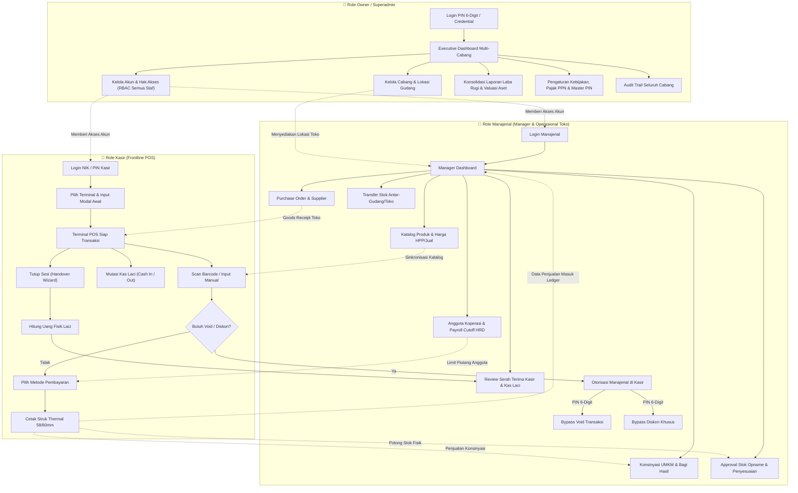
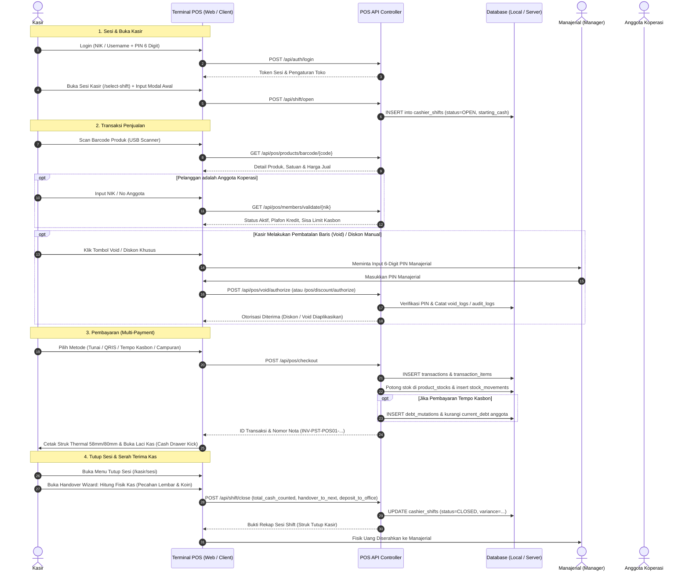
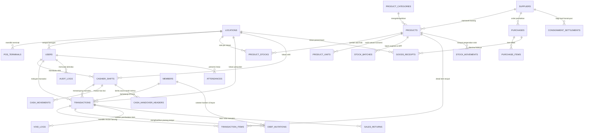
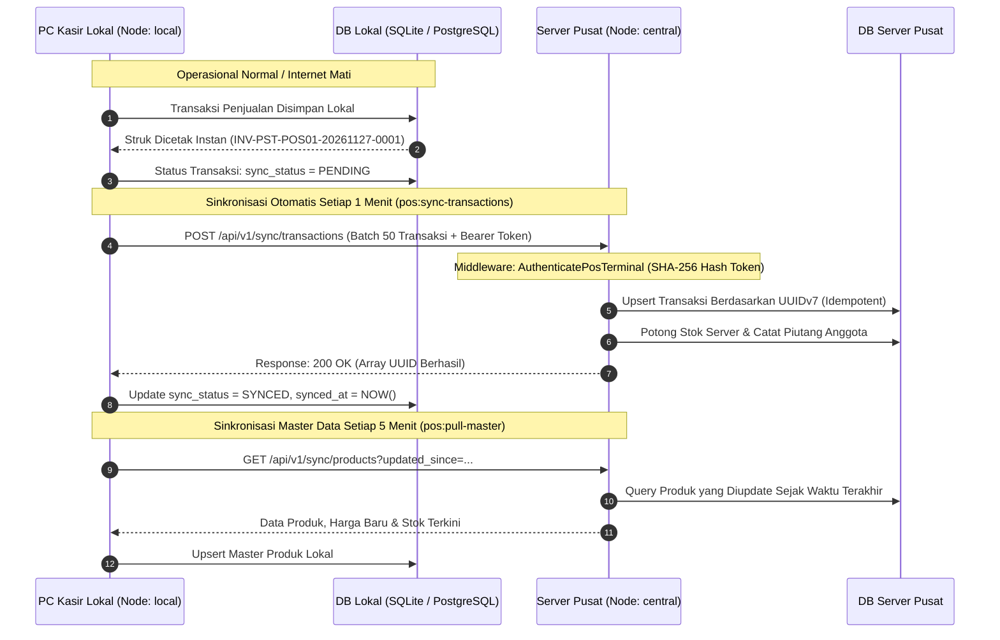

# 🧭 DOKUMENTASI FLOW SISTEM DAN RELASI PER ROLE
## Sistem Kasir (Point of Sale) & Retail Management Minimarket Koperasi PT Indo Lampung Perkasa (ILP POS)

---

### 📌 Ringkasan Eksekutif & Struktur Hak Akses

Sistem POS Minimarket Koperasi PT ILP dirancang dengan arsitektur **Hybrid Distributed (Offline-First POS Client + Cloud/Central Server)** yang menghubungkan lini operasional kasir di toko dengan kontrol manajerial dan pengawasan eksekutif pemilik (*Owner*). 

Sistem secara ketat membagi operasional ke dalam **3 Peran (Role)**:
1. **Kasir (Cashier Frontline)**: Pelaksana transaksi di garis depan, pencatatan mutasi laci, dan serah terima shift.
2. **Manajerial (Manager & Store Operations)**: Pengendali penuh operasional toko, pemegang otorisasi PIN untuk tindakan kasir (*Void* & Diskon Khusus), logistik gudang, pengadaan barang (*purchasing*), manajemen anggota koperasi, rekonsiliasi konsinyasi UMKM, dan cutoff payroll kasbon ke HRD.
3. **Owner / Superadmin**: Pengawas strategis multi-cabang, pengambil kebijakan identitas toko & perpajakan, tata kelola akun & RBAC seluruh staf, konsolidasi laporan laba rugi, dan audit trail seluruh aktivitas sistem.

---

## 🗺️ DAFTAR ISI

1. [Peta Hak Akses & Matriks Kewenangan 3 Role](#1-peta-hak-akses--matriks-kewenangan-3-role)
2. [Flow Operasional Per Role & Relasinya](#2-flow-operasional-per-role--relasinya)
   - [2.1 Role Kasir (Frontline POS)](#21-role-kasir-frontline-pos)
   - [2.2 Role Manajerial (Managerial & Operasional Toko)](#22-role-manajerial-managerial--operasional-toko)
   - [2.3 Role Owner / Superadmin (Eksekutif & Multi-Cabang)](#23-role-owner--superadmin-eksekutif--multi-cabang)
3. [Relasi Antar-Role (Cross-Role Business Process Handoffs)](#3-relasi-antar-role-cross-role-business-process-handoffs)
4. [Relasi Data & Database Entity Relationship (ERD)](#4-relasi-data--database-entity-relationship-erd)
5. [Relasi Sinkronisasi Node (PC Kasir Lokal ↔ Server Pusat)](#5-relasi-sinkronisasi-node-pc-kasir-lokal--server-pusat)

---

## 1. Peta Hak Akses & Matriks Kewenangan 3 Role

Akses aplikasi diproteksi secara ketat pada level Web Navigation maupun RESTful API:
- **Web Navigation Middleware**: `auth.web:kasir`, `auth.web:manager`, `auth.web:owner`
- **REST API Middleware**: `auth.api:kasir`, `auth.api:manager`, `auth.api:owner`
- **Terminal Sync Middleware**: `AuthenticatePosTerminal` (Token Bearer SHA-256)

| Fitur / Modul Operasional | Kasir | Manajerial | Owner / Superadmin |
|---|:---:|:---:|:---:|
| **Buka & Tutup Sesi Shift (Modal Laci & Handover)** | ✅ | 👁️ (Review & Terima Kas) | 👁️ (Audit Eksekutif) |
| **Transaksi POS & Scan Barcode Produk** | ✅ | ❌ | ❌ |
| **Multi-Payment (Tunai, QRIS, Kasbon Anggota, Kupon BBM)** | ✅ | ❌ | ❌ |
| **Hold & Resume Transaksi Keranjang** | ✅ | ❌ | ❌ |
| **Otorisasi PIN Void & Diskon Khusus Kasir** | ❌ (Meminta) | ✅ (Otorisasi PIN 6-Digit) | ✅ (Master PIN Otorisasi) |
| **Penerimaan Barang Masuk Toko (Goods Receipt)** | ✅ (Cek Fisik) | ✅ (Buat & Approve) | 👁️ (Audit Logistik) |
| **Audit Fisik Stok Opname Harian Toko** | ✅ (Hitung Rak) | ✅ (Approval & Koreksi) | 👁️ (Laporan Selisih) |
| **Retur Penjualan Kasir (Pelanggan)** | ✅ (Nota Retur) | ✅ (Approval & Verifikasi) | 👁️ (Audit) |
| **Master Data Produk, Kategori & Harga Jual** | 👁️ (Lihat Rak) | ✅ (CRUD Penuh) | ✅ (Full Control) |
| **Pembelian (Purchase Order) & Supplier** | ❌ | ✅ (Buat & Kelola) | 👁️ (Kontrol Biaya) |
| **Transfer Stok Antar Gudang & Toko** | ❌ | ✅ (Kirim & Terima) | 👁️ (Monitoring) |
| **Kemitraan UMKM & Settlement Konsinyasi** | ❌ | ✅ (Kelola & Bayar) | ✅ (Bagi Hasil) |
| **Pengelolaan Anggota & Plafon Kasbon** | 👁️ (Cek Kuota) | ✅ (CRUD & Limit) | ✅ (Bulk Limit) |
| **Eksekusi Payroll Cutoff Kasbon ke HRD** | ❌ | ✅ (Generate CSV Cutoff) | ✅ (Approval Akhir) |
| **Laporan Omzet, HPP & Laba Rugi Toko** | 👁️ (Shift Sendiri) | ✅ (Laporan Lengkap Toko) | ✅ (Konsolidasi Multi-Cabang) |
| **Kelola Akun, Role & Reset PIN Karyawan** | ❌ | ⚠️ (Akun Kasir Cabangnya) | ✅ (Semua Akun & Cabang) |
| **Manajemen Cabang & Gudang Logistik** | ❌ | ❌ | ✅ (Tambah & Atur) |
| **Pengaturan Pajak (PPN), Kebijakan Toko & Master PIN** | ❌ | ⚠️ (Profil Toko) | ✅ (Kebijakan Utama Sistem) |
| **System Security Audit Trail & Log Aktivitas** | ❌ | 👁️ (Toko Sendiri) | ✅ (Seluruh Cabang) |

---

## 2. Flow Operasional Per Role & Relasinya

---

### 2.1 Role Kasir (Frontline POS)

Role kasir difokuskan pada kecepatan layanan pelanggan (*high-speed frontline checkout*), ketelitian arus kas laci, dan pencatatan retur.

#### Alur Lengkap Kasir:
1. **Autentikasi & Presensi**:
   - Kasir login di `/login-kasir` menggunakan Username/NIK dan Password atau PIN 6-digit.
   - Sistem otomatis mencatat **Presensi Masuk (Check-in Attendance)** dan mengirim audit log ke Server.
2. **Pembukaan Sesi Laci Kasir (`/select-shift`)**:
   - Kasir memilih terminal kasir (`POS-01` s/d `POS-12`).
   - Kasir menginput modal awal kas (*starting cash*) yang diserahkan dari brankas/shift sebelumnya.
   - Sesi kasir berstatus `OPEN` tersimpan di `cashier_shifts`.
3. **Pelayanan Transaksi POS (`/pos`)**:
   - **Pencarian Produk**: Scan barcode via USB Barcode Scanner (auto-enter) atau cari nama/SKU produk.
   - **Multi-Satuan**: Kasir dapat memilih satuan penjualan (Pcs, Renceng, Dus) yang secara otomatis menghitung faktor konversi stok.
   - **Promo Otomatis**: Diskon barang mendekati kadaluarsa (*expiring discount* H-30 / H-14), kupon promosi, dan promo *Buy 1 Get 1* teraplikasikan otomatis.
   - **Kupon BBM Karyawan**: Transaksi dapat menukarkan kupon BBM yang memotong saldo unit kupon di tabel `coupon_units`.
   - **Hold & Resume**: Kasir dapat menahan transaksi sementara (*Hold Bill*) saat pembeli mengambil barang tambahan, lalu melanjutkannya (*Resume*) tanpa kehilangan antrean.
4. **Otorisasi Khusus di Meja Kasir**:
   - **Void Barang**: Jika ada pembatalan item setelah discan, wajib otorisasi PIN 6-digit Manajerial.
   - **Diskon Manual / Grosir**: Pemberian potongan harga khusus di luar promo sistem wajib otorisasi PIN Manajerial.
5. **Pilihan Pembayaran & Struk**:
   - **Tunai**: Menghitung nominal bayar, kalkulator uang kembali otomatis, tombol pecahan cepat.
   - **QRIS Dinamis**: Tampil QRIS terintegrasi pada layar kasir.
   - **Kasbon Anggota (Tempo)**: Khusus karyawan PT ILP. Sistem memverifikasi NIK, status keanggotaan aktif, dan memastikan nominal belanja tidak melebihi sisa limit plafon kredit.
   - **Split Payment**: Kombinasi pembayaran (contoh: Rp 50.000 tunai + sisanya kasbon/QRIS).
   - **Cetak Struk**: Output format cetak thermal 58mm atau 80mm ESC/POS.
6. **Mutasi Arus Kas Laci (*Cash Movement*)**:
   - Menu catat kas masuk (*Cash In*, misal: tambahan modal uang receh dari brankas).
   - Menu catat kas keluar (*Cash Out / Petty Cash*, misal: pembelian darurat kantong plastik/air galon).
7. **Penerimaan Barang Toko (*Goods Receipt*)**:
   - Kasir dapat memeriksa surat jalan barang masuk dari gudang pusat/supplier di toko dan memverifikasi jumlah fisik yang diterima.
8. **Stok Opname Rak Harian (`/kasir/stock-opname`)**:
   - Kasir menghitung fisik produk per rak/gondola untuk mendeteksi kehilangan/selisih sejak dini.
9. **Retur Penjualan Kasir (`/kasir/retur`)**:
   - Kasir melayani komplain pelanggan (barang rusak/kadaluarsa), mencatat alasan, mencetak bukti retur, dan mengembalikan dana (*refund*) setelah disetujui Manajerial.
10. **Tutup Sesi & Wizard Serah Terima Laci (`Cash Handover Wizard`)**:
    - Kasir membuka form tutup shift di `/kasir/sesi`.
    - Sistem menampilkan komparasi data sistem (modal awal + total tunai + cash in - cash out).
    - Kasir memasukkan rincian fisik uang laci (pecahan Rp 100.000 s/d Rp 100 koin) pada *Denomination Calculator*.
    - Sistem menghitung selisih kas (*Variance*: Sesuai / Selisih Lebih / Selisih Kurang).
    - Pembagian alokasi: sebagian uang ditinggal untuk modal kasir shift berikutnya (*Handover*), sisanya disetor ke brankas Manajerial (*Deposit*).
    - Kasir logout, sistem otomatis mencatat **Presensi Keluar (Check-out Attendance)**.

---

### 2.2 Role Manajerial (Managerial & Operasional Toko)

Role Manajerial mengontrol penuh perputaran stok, rantai pasok (*supply chain*), kebijakan piutang karyawan, otorisasi meja kasir, dan pelaporan keuangan toko.

```mermaid
flowchart TD
    M[💼 Role Manajerial] --> M_OTO[Otorisasi Operasional & Kasir]
    M --> M_INV[Manajemen Inventori & Logistik]
    M --> M_PUR[Pengadaan & Supplier]
    M --> M_MEM[Anggota Koperasi & Kasbon]
    M --> M_UMKM[Mitra Konsinyasi UMKM]
    M --> M_ACC[Akuntansi & Laporan Toko]
    M --> M_HR[Absensi & Staf Kasir]

    M_OTO --> O1[PIN Otorisasi Void Barang Kasir]
    M_OTO --> O2[PIN Otorisasi Diskon Khusus]
    M_OTO --> O3[Verifikasi Fisik Serah Terima Kasir]

    M_INV --> I1[Master Produk, Satuan & HPP]
    M_INV --> I2[Approval Penyesuaian Stok Opname]
    M_INV --> I3[Transfer Stok Antar Gudang/Toko]
    
    M_PUR --> P1[Purchase Order ke Supplier]
    M_PUR --> P2[Approval Goods Receipt Masuk]
    M_PUR --> P3[Retur Pembelian ke Supplier]

    M_MEM --> ME1[Pendaftaran & Kelola Anggota]
    M_MEM --> ME2[Set Plafon Kredit Kasbon]
    M_MEM --> ME3[Generate File Cutoff Payroll ke HRD]

    M_UMKM --> U1[Daftar Mitra Konsinyasi]
    M_UMKM --> U2[Bagi Hasil Penjualan UMKM]
    M_UMKM --> U3[Settlement & Pembayaran Mitra]

    M_ACC --> A1[Laporan Omzet & Laba Rugi]
    M_ACC --> A2[Rekapitulasi Kasir & Arus Kas]
    M_ACC --> A3[Jurnal Umum & Buku Besar]
```

#### Alur Lengkap Manajerial:
1. **Otorisasi Frontline di Meja Kasir**:
   - Memasukkan 6-digit PIN Manajerial langsung pada form kasir ketika kasir membutuhkan otorisasi pembatalan baris barang (*Void*), pembatalan nota, atau pemberian diskon khusus.
   - Seluruh otorisasi manajerial tercatat di tabel `void_logs` dan `audit_logs`.
2. **Dashboard Operasional Toko (`/dashboard`)**:
   - Memantau omzet harian/bulanan, laba kotor (*gross profit*), jumlah struk transaksi, dan perbandingan kas tunai vs non-tunai.
   - Memantau peringatan stok menipis (*Low Stock Alert*) dan produk mendekati tanggal kadaluarsa.
3. **Master Produk & Multi-Satuan (`/inventory`)**:
   - Menambah, memperbarui, dan menonaktifkan master data barang.
   - Mengatur multi-satuan per produk (misal: Beli per Karton @ isi 24 Pcs, Jual per Pcs atau Pack).
   - Menetapkan harga modal (HPP), harga eceran umum, dan harga khusus anggota koperasi.
   - Mencetak label barcode untuk rak toko.
4. **Pengadaan Barang & Manajemen Supplier (`/pembelian-barang`, `/suppliers`)**:
   - Membuat order pembelian (*Purchase Order*).
   - Memverifikasi penerimaan barang fisik di gudang/toko (*Goods Receipt*).
   - Sistem secara otomatis mencatat riwayat perubahan harga beli (*Purchase Price History*) dan membuat batch stok baru (*Stock Batches*).
5. **Pengelolaan Permintaan & Transfer Stok Antar Gudang/Toko (`/kirim-barang`)**:
   - Mengatur mutasi distribusi barang dari Gudang Pusat (*Warehouse*) ke Toko Retail (*Store*), atau transfer antar-cabang.
   - Status tracking mutasi stok: *Draft* ➔ *In Transit* ➔ *Received*.
6. **Stock Opname & Approval Penyesuaian Stok (`/stock-opname`)**:
   - Membuka periode audit fisik stok (tahunan/bulanan/rak berkala).
   - Membandingkan stok sistem vs stok hitung fisik kasir.
   - Melakukan persetujuan penyesuaian (*Approve Stock Adjustment*). Sistem otomatis menerbitkan mutasi penyesuaian di `stock_corrections` dan `stock_movements`.
7. **Pengelolaan Anggota Koperasi & Kasbon Karyawan (`/members`)**:
   - Mendaftarkan anggota koperasi baru (Nama, NIK Karyawan PT ILP, Unit/Departemen Kerja, No HP, Plafon Kredit).
   - Mengatur limit belanja tempo per anggota.
   - Melihat mutasi kasbon harian (*Debt Mutations*) dari belanja kasir.
8. **Proses Payroll Cutoff Piutang ke HRD PT ILP (`/reports/member-debts`)**:
   - Menjelang tanggal penggajian (misal tanggal 20 atau 25 setiap bulan), Manajerial menarik rekap kasbon seluruh karyawan.
   - Melakukan eksekusi *Payroll Cutoff*: mengunci saldo piutang periode berjalan dan mengekspor rekapitulasi data potong gaji untuk diserahkan ke bagian HRD / Payroll PT ILP.
   - Saat pembayaran gaji cair, Manajerial mencatat pelunasan massal (*Bulk Settle*).
9. **Kemitraan UMKM & Konsinyasi (`/umkm-partners`)**:
   - Mendata UMKM binaan lokal yang menitipkan produk olahan makanan/minuman di minimarket.
   - Menetapkan persentase bagi hasil (*revenue share*, misal: 85% UMKM, 15% Koperasi).
   - Melihat laporan penjualan produk konsinyasi secara real-time dari transaksi kasir.
   - Menghasilkan bukti pembayaran berkala (*Settlement Voucher*) ke mitra UMKM.
10. **Promosi & Kupon Diskon (`/promosi`, `/kupon`)**:
    - Mengonfigurasi skema promo: Diskon Persentase, Potongan Nominal, Diskon Minimum Belanja, dan *Buy X Get Y*.
    - Menerbitkan voucher diskon dan kupon belanja khusus hari raya / rapat anggota tahunan.
11. **Laporan & Akuntansi Toko (`/reports`)**:
    - Rekapitulasi transaksi kasir per shift, per terminal, dan per petugas.
    - Laporan Laba Rugi Toko (Pendapatan Penjualan - HPP - Biaya Operasional Kas Kecil).
    - Laporan arus kas harian (*Cash Flow Summary*).
    - Integrasi otomatis ke jurnal pembukuan akuntansi dasar (`journal_entries` dan `journal_entry_lines`).
12. **Monitoring Absensi & Karyawan Toko (`/absensi`, `/kelola-akun`)**:
    - Memantau log jam datang dan jam pulang kasir.
    - Mengelola akun kasir di bawah cabangnya (pembuatan akun kasir, atur terminal tugas, reset password/PIN).

---

### 2.3 Role Owner / Superadmin (Eksekutif & Multi-Cabang)

Role Owner / Superadmin adalah otoritas tertinggi sistem untuk pengawasan strategis bisnis multi-cabang, tata kelola keamanan, dan integrasi korporasi.

```mermaid
flowchart TD
    O[👑 Owner / Superadmin] --> O_DASH[Dashboard Eksekutif Multi-Cabang]
    O --> O_BRANCH[Tata Kelola Cabang & Gudang]
    O --> O_RBAC[RBAC & Keamanan Pengguna]
    O --> O_FIN[Laporan Konsolidasi & Valuasi]
    O --> O_SET[Kebijakan Koperasi, Pajak & Master PIN]
    O --> O_AUDIT[Audit Trail Seluruh Cabang]

    O_DASH --> D1[Omzet Total Semua Cabang]
    O_DASH --> D2[Performa Tiap Toko & Gudang]
    
    O_BRANCH --> B1[Tambah Cabang Baru]
    O_BRANCH --> B2[Set Gudang Logistik]

    O_RBAC --> R1[Kelola Akun Seluruh Staf Manajerial & Kasir]
    O_RBAC --> R2[Multi-Branch Access Assignment]
    O_RBAC --> R3[Reset Master Kredensial]

    O_FIN --> F1[Laba Rugi Konsolidasi PT ILP]
    O_FIN --> F2[Valuasi Aset Inventaris Seluruh Lokasi]
    O_FIN --> F3[Pengawasan Piutang Karyawan Pabrik]

    O_SET --> S1[Tarif PPN 11% / 12%]
    O_SET --> S2[Master PIN Otorisasi Darurat]
    O_SET --> S3[Legalitas & Identitas Koperasi]

    O_AUDIT --> AU1[Log Akses Login/Logout]
    O_AUDIT --> AU2[Log Void, Diskon & Koreksi Stok]
    O_AUDIT --> AU3[Log Perubahan Konfigurasi Sistem]
```

#### Alur Lengkap Owner / Superadmin:
1. **Autentikasi Cepat Eksekutif**:
   - Dapat login menggunakan Username & Password atau langsung memasukkan **6-Digit Numeric PIN Pad** di halaman awal `/`.
2. **Dashboard Eksekutif Konsol Multi-Cabang (`/owner`)**:
   - Menampilkan metrik agregat seluruh cabang PT ILP (Cabang Pusat, Cabang Pabrik/Mill, Cabang Kebun Barat, dll.).
   - Analitik tren omzet harian/mingguan/bulanan, perbandingan margin laba kotor antar-cabang, total nilai transaksi piutang belanja karyawan, dan valuasi aset persediaan di toko maupun gudang.
3. **Manajemen Cabang & Fasilitas Logistik (`/owner/cabang`)**:
   - Menambah cabang toko retail (*STORE*) atau gudang penyimpanan (*WAREHOUSE*).
   - Menentukan manajer penanggung jawab cabang, alamat, telepon, dan status aktif/non-aktif.
4. **Tata Kelola Akun Karyawan & RBAC Penuh (`/owner/kelola-akun`)**:
   - Mengelola akun seluruh staf (Kasir, Manajerial, dan sesama Owner).
   - Mengatur penugasan cabang (*Branch Assignment*): apakah staf ditugaskan pada satu toko spesifik atau dapat mengakses multi-cabang.
   - Mengaktifkan/menonaktifkan akun karyawan yang mutasi atau berhenti bekerja.
5. **Kebijakan Strategis Koperasi & Perpajakan (`/owner/settings`)**:
   - Mengonfigurasi parameter pajak pertambahan nilai (PPN 11% / 12%) yang berlaku di struk belanja.
   - Mengatur kebijakan keamanan: mewajibkan PIN pada void transaksi, mewajibkan PIN pada diskon di atas ambang batas tertentu, serta menyetel **Master PIN Otorisasi Darurat**.
   - Mengatur profil legalitas Koperasi PT Indo Lampung Perkasa (NPWP, Nomor Induk Koperasi, Rekening Bank).
6. **Konsolidasi Keuangan & Portofolio Kemitraan (`/owner/reports`, `/owner/umkm-partners`)**:
   - Menganalisis laporan laba rugi konsolidasi, perputaran piutang anggota pabrik, dan bagi hasil mitra UMKM.
7. **System Audit Trail & Log Keamanan (`/owner/audit-log`)**:
   - Memeriksa jejak audit komprehensif sistem: siapa yang melakukan void, akun manajerial yang mengizinkan, kapan terjadi perubahan harga master barang, siapa yang mengedit limit kasbon anggota, dan riwayat login/logout seluruh personel.

---

## 3. Relasi Antar-Role (Cross-Role Business Process Handoffs)

Tabel berikut merangkum proses bisnis yang membutuhkan interaksi antar-peran dalam sistem 3 role:

| No | Proses Bisnis | Role Pemrakarsa | Role Penerima / Verifikator | Titik Relasi Data / Sistem | Dampak Terhadap Bisnis |
|---|---|---|---|---|---|
| **1** | **Otorisasi Void Transaksi** | Kasir | Manajerial (atau Owner via Master PIN) | Form modal PIN di `/pos` ➔ `POST /api/pos/void/authorize` ➔ Tabel `void_logs` & `audit_logs` | Mencegah kecurangan kasir membatalkan nota tanpa izin pelanggan/atasan. |
| **2** | **Otorisasi Diskon Khusus** | Kasir | Manajerial | Form modal PIN di `/pos` ➔ `POST /api/pos/discount/authorize` | Memberikan fleksibilitas diskon grosir dengan pengawasan pimpinan toko. |
| **3** | **Serah Terima Laci Kasir (Handover)** | Kasir | Manajerial | Wizard di `/kasir/sesi` ➔ Tabel `cashier_shifts` & `cash_handover_headers` | Rekonsiliasi fisik uang tunai laci, pelaporan selisih kas, dan penyetoran uang ke brankas manajerial. |
| **4** | **Belanja Kasbon Anggota Koperasi** | Kasir | Anggota (Validasi) ➔ Manajerial / HRD (Payroll) | Input NIK di `/pos` ➔ Validasi limit `members` ➔ Catat `debt_mutations` ➔ Laporan Cutoff HRD | Memfasilitasi belanja kebutuhan pokok karyawan dengan jaminan potong gaji. |
| **5** | **Penerimaan Barang Toko (Goods Receipt)** | Manajerial (PO) | Kasir (Cek Fisik) | Surat jalan di `/kirim-barang` ➔ Verifikasi fisik di `/kasir` ➔ Update `product_stocks` | Menjamin jumlah barang kiriman gudang/supplier sesuai dengan fisik rak toko. |
| **6** | **Audit Stok Opname Rak** | Kasir (Hitung Fisik) | Manajerial (Approval Koreksi) | Form opname di `/kasir/stock-opname` ➔ Approval di `/stock-opname` ➔ `stock_corrections` | Mencegah kebocoran stok (*shrinkage*) dan menyesuaikan nilai inventaris buku. |
| **7** | **Retur Pembelian ke Supplier** | Kasir (Lapor Rusak) | Manajerial (Klaim Retur) | Retur barang di `/retur` ➔ Update saldo hutang/uang kembali supplier | Mengganti produk cacat pabrik atau kadaluarsa ke vendor/supplier. |
| **8** | **Bagi Hasil Konsinyasi UMKM** | Kasir (Jual Produk) | Manajerial (Rekonsiliasi) ➔ Owner (Approval) | Transaksi kasir ➔ Filter `supplier_type=CONSIGNMENT` ➔ `consignment_settlements` | Transparansi dan akurasi pembayaran bagi hasil produk titipan mitra UMKM. |
| **9** | **Pengawasan Multi-Cabang & RBAC** | Owner | Manajerial & Kasir | Menu `/owner/kelola-akun` & `/owner/cabang` ➔ Tabel `users` & `locations` | Kontrol terpusat atas wewenang penugasan karyawan di seluruh jaringan toko. |

---

## 4. Relasi Data & Database Entity Relationship (ERD)

Sistem menggunakan skema basis data relasional yang kokoh dengan arsitektur **Dual-Key**:
- `id` (BIGINT Autoincrement) untuk *primary key* internal yang cepat pada join lokal.
- `uuid` (UUIDv7 berbasis waktu) untuk integritas identitas global yang aman dari tabrakan (*collision-free*) saat sinkronisasi antar-node.

### Penjelasan Kunci Hubungan Tabel Utama:
1. **`locations` (Cabang Toko / Gudang)**:
   - Menjadi jangkar utama multi-cabang. Menghubungkan terminal kasir (`pos_terminals`), penugasan user (`users`), stok barang per lokasi (`product_stocks`), dan seluruh transaksi penjualan (`transactions`).
2. **`cashier_shifts` & `transactions`**:
   - Setiap transaksi kasir **wajib** terikat ke satu sesi shift yang aktif (`cashier_shift_id`). Hal ini menjamin bahwa seluruh uang penjualan (tunai/non-tunai) dapat dirunut (*traceable*) ke petugas dan terminal kasir terkait.
3. **`products` & `product_stocks` & `stock_movements`**:
   - Saldo stok barang dicatat per lokasi toko/gudang pada `product_stocks`, dan setiap mutasi (penjualan, penerimaan, retur, koreksi opname) mencatat kartu stok digital di `stock_movements`.
4. **`members` & `debt_mutations`**:
   - Saat kasir memilih metode pembayaran *Tempo Kasbon*, sistem mengecek limit kredit di tabel `members`. Transaksi berhasil akan mendebit saldo kasbon anggota dan mencatat mutasi di `debt_mutations` dengan referensi nomor invoice transaksi.
5. **`pos_terminals`**:
   - Menyimpan identitas setiap mesin kasir fisik, kode terminal (`POS-01`), dan hash token otentikasi SHA-256 (`api_token_hash`) untuk mengontrol izin sinkronisasi data ke server pusat.

---

## 5. Relasi Sinkronisasi Node (PC Kasir Lokal ↔ Server Pusat)

Untuk menjamin kelancaran transaksi minimarket saat jaringan internet putus atau lambat, sistem mengimplementasikan arsitektur **Offline-First Synchronous Resilience**:

### Mekanisme Anti-Konflik & Ketahanan Sinkronisasi:
1. **Penomoran Invoice Terisolasi**:
   - Format: `INV-{KODE_CABANG}-{KODE_TERMINAL}-{YYYYMMDD}-{URUTAN}` (Contoh: `INV-PST-POS01-20261127-0042`).
   - Penomoran tidak akan bentrok meskipun kasir `POS-01` dan `POS-02` bertransaksi bersamaan saat offline.
2. **Identitas Global UUIDv7**:
   - Seluruh record transaksi, mutasi shift, dan log dibuat dengan UUIDv7 lokal yang unik di dunia dan berurutan secara kronologis waktu.
3. **Idempotent Batch Sync**:
   - Jika koneksi terputus di tengah pengiriman batch transaksi, PC kasir akan mengirim ulang batch tersebut. Server pusat mendeteksi UUID yang sama dan melakukan operasi *idempotent upsert* tanpa pernah menduplikasi transaksi atau memotong stok ganda.
4. **Master Data Incremental Pull**:
   - PC kasir secara periodik hanya menarik data produk, anggota, dan promo yang mengalami perubahan (`updated_at > last_synced_at`), menghemat kuota internet dan menjaga kecepatan respon.
