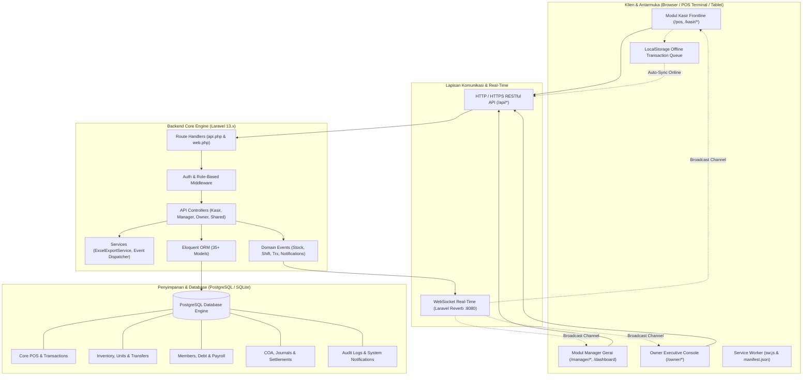

# 📘 DOKUMENTASI KOMPREHENSIF BACKEND & ARSITEKTUR SISTEM POS
## Sistem Kasir (Point of Sale) & Retail Management Minimarket Koperasi PT Indo Lampung Perkasa (ILP POS)

---

### 📌 Ringkasan Eksekutif & Status Sistem

| Parameter | Spesifikasi |
|---|---|
| **Aplikasi** | POS Minimarket & Retail Management System Koperasi PT Indo Lampung Perkasa |
| **Framework Backend** | **Laravel 13.x** (v13.17.0, PHP 8.3+) |
| **Database** | **PostgreSQL** (Production/Staging Ready) / **SQLite** (Local Dev/Testing) |
| **WebSocket / Real-time** | **Laravel Reverb** (Pusher Protocol Compatible, Port 8080) |
| **Frontend Stack** | **Blade Templates**, **Tailwind CSS v3**, **Alpine.js v3** |
| **Ketahanan Jaringan** | **Offline-First PWA** (Service Worker, LocalStorage Queue, Idempotent Sync) |
| **Cakupan Akses Pengguna** | 4 Level Hak Akses: **Kasir**, **Supervisor**, **Manager**, **Owner / Superadmin** |
| **Status Uji Mutu (Test Suite)** | **100% Passed (87 Tests, 960 Assertions — 0 Failure)** |
| **Tanggal Pembaruan** | **13 November 2026** |

---

## 📑 DAFTAR ISI

1. [Arsitektur Sistem & Spesifikasi Teknologi](#1-arsitektur-sistem--spesifikasi-teknologi)
2. [Rincian Pengerjaan Backend Per Modul](#2-rincian-pengerjaan-backend-per-modul)
   - [2.1 Modul Autentikasi, Keamanan & RBAC](#21-modul-autentikasi-keamanan--rbac)
   - [2.2 Modul A: Frontline POS, Sesi Kasir & Transaksi Multi-Payment](#22-modul-a-frontline-pos-sesi-kasir--transaksi-multi-payment)
   - [2.3 Modul B: Anggota Koperasi, Kasbon & Payroll Cutoff HRD](#23-modul-b-anggota-koperasi-kasbon--payroll-cutoff-hrd)
   - [2.4 Modul C: Inventori, Multi-Satuan, Stock Opname & Konsinyasi UMKM](#24-modul-c-inventori-multi-satuan-stock-opname--konsinyasi-umkm)
   - [2.5 Modul Logistik: Distribusi Gudang ke Toko & Retur](#25-modul-logistik-distribusi-gudang-ke-toko--retur)
   - [2.6 Modul D: Owner Executive Console & Multi-Cabang](#26-modul-d-owner-executive-console--multi-cabang)
   - [2.7 Modul E: Pelaporan Keuangan, Akuntansi & Kupon BBM](#27-modul-e-pelaporan-keuangan-akuntansi--kupon-bbm)
   - [2.8 Modul Real-Time Event & Pusat Notifikasi Sistem](#28-modul-real-time-event--pusat-notifikasi-sistem)
3. [Katalog Lengkap RESTful API Endpoints](#3-katalog-lengkap-restful-api-endpoints)
4. [Skema Database, Model Eloquent & Relasi (ERD)](#4-skema-database-model-eloquent--relasi-erd)
5. [Arsitektur Frontend, Komponen & Resiliensi Client-Side](#5-arsitektur-frontend-komponen--resiliensi-client-side)
6. [Layanan Pendukung & Background Processing](#6-layanan-pendukung--background-processing)
7. [Panduan Pengujian (Testing), Migrasi & Deployment](#7-panduan-pengujian-testing-migrasi--deployment)

---

## 1. Arsitektur Sistem & Spesifikasi Teknologi

Sistem POS Minimarket Koperasi PT Indo Lampung Perkasa dirancang dengan arsitektur **Hybrid Decoupled**:
- **Backend API-Centric**: Logika bisnis, validasi keuangan, mutasi stok, dan otorisasi dibungkus dalam RESTful API berbasis JSON yang aman, modular, dan dapat diintegrasikan dengan aplikasi mobile atau hardware scanner/timbangan masa depan.
- **Frontend Reaktif Modern**: Menggunakan kombinasi Laravel Blade Templates untuk performa server rendering instan (SEO & load time cepat) dan **Alpine.js v3** untuk reaktivitas antarmuka tanpa overhead framework SPA yang berat.
- **Dual-Layer Resilience**: Memadukan panggilan API langsung dengan mekanisme fallback ke penyimpanan lokal (*LocalStorage & IndexedDB*) saat koneksi jaringan terputus.



---

## 2. Rincian Pengerjaan Backend Per Modul

### 2.1 Modul Autentikasi, Keamanan & RBAC
- **Multi-Role Login Portal**:
  - Kasir login dengan **NIK / Username** dan **PIN 6-digit** numerik.
  - Manager login dengan **Username** dan **Password** terenkripsi (Bcrypt/Argon2id).
  - Owner / Superadmin login instan dengan **6-Digit PIN Pad** terenkripsi.
- **Supervisor PIN Pad Otorisasi (Anti-Fraud)**:
  - Kasir tidak diizinkan membatalkan item (*Void Item*), membatalkan seluruh transaksi (*Void Bill*), atau memberikan diskon manual tanpa persetujuan Supervisor/Manager.
  - Endpoint `POST /api/pos/void/authorize` memverifikasi PIN Supervisor secara ketat dan otomatis menolak jika PIN yang dimasukkan adalah milik sesama Kasir.
- **Audit Trail Terintegrasi (`AuditLog`)**:
  - Model `App\Models\AuditLog` mencatat setiap aksi strategis: perubahan data cabang, pengubahan limit kredit anggota, void transaksi, koreksi stok, perubahan password, dan penyesuaian tarif PPN.
  - Menyimpan metadata JSON `changes` (nilai sebelum vs sesudah), `ip_address`, `user_id`, dan timestamp.

---

### 2.2 Modul A: Frontline POS, Sesi Kasir & Transaksi Multi-Payment
- **Manajemen 12 Terminal Kasir & Sesi Shift**:
  - Mendukung hingga 12 terminal independen (`Kasir 01` s/d `Kasir 12`).
  - Status terminal visual: `AVAILABLE`, `OCCUPIED`, `HANDOVER_PENDING`.
  - Kasir dapat melakukan *Resumption* (melanjutkan transaksi pada sesi aktif tanpa mengisi ulang modal).
- **Wizard Tutup Sesi & Serah Terima Kas 3 Langkah (*Cash Handover Wizard*)**:
  1. *Blind Count*: Kasir menghitung nominal fisik laci kasir menggunakan kalkulator pecahan uang (lembar Rp 100.000 s/d Rp 1.000 dan koin Rp 1.000 s/d Rp 100) tanpa melihat saldo sistem.
  2. *Rekonsiliasi Varians*: Sistem membandingkan saldo kalkulasi vs saldo fisik, mengelompokkan status menjadi `SESUAI`, `SELISIH KURANG`, atau `SELISIH LEBIH`, serta mewajibkan catatan justifikasi jika terjadi selisih.
  3. *Alokasi Serah Terima*: Saldo fisik dapat dialokasikan untuk diserahkan ke kasir shift berikutnya (*Handover*) atau disetorkan ke brankas/supervisor (*Drop Safe*).
- **Mutasi Kas Laci (*Petty Cash Move*)**:
  - Kasir dapat mencatat kas masuk tambahan (*Cash In*) atau pengeluaran operasional kecil (*Cash Out / Petty Cash*) dengan alasan transaksi langsung ke tabel `cashier_shifts`.
- **Mesin Transaksi & Checkout**:
  - Pencarian barang super cepat dengan pola regex dan barcode lookup.
  - **Auto-Discount Barang Expired**: Potongan harga otomatis sebesar 10% untuk barang mendekati kadaluarsa H-30 dan 25% untuk H-14.
  - **Multi-Metode Pembayaran**:
    - Tunai (dengan kalkulator kembalian & tombol uang pas cepat).
    - Non-tunai (QRIS Statis/Dinamis, Kartu Debit/Kredit EDC).
    - Piutang / Kasbon Anggota Koperasi (validasi plafon kredit sisa).
    - Pembayaran Campuran (*Split Payment* sebagian tunai dan non-tunai).
- **Hold & Recall Bill**:
  - Kasir dapat menahan transaksi aktif pelanggan saat pelanggan mengambil barang tambahan, lalu melanjutkan transaksi pelanggan lain tanpa kehilangan isi keranjang.
- **Offline-First Resilience**:
  - Transaksi yang terjadi saat jaringan mati tersimpan di antrean offline (*Pending Sync Queue*), struk tetap dapat dicetak, dan disinkronkan secara idempoten via `POST /api/pos/sync-offline` ketika online.

---

### 2.3 Modul B: Anggota Koperasi, Kasbon & Payroll Cutoff HRD
- **Direktori Anggota Multi-Cabang**:
  - Pengelolaan database anggota dari 3 unit kerja: Mill (Pabrik), Kebun Barat, dan Kebun Timur.
  - Validasi NIK instan saat transaksi di kasir untuk memastikan status keanggotaan aktif dan memeriksa sisa limit belanja.
- **Plafon Kredit Belanja & Mutasi Piutang**:
  - Penentuan batas maksimal belanja kasbon per anggota.
  - Setiap transaksi kredit otomatis memotong sisa limit dan mencatat riwayat di tabel `debt_mutations`.
- **Integrasi Payroll Cutoff ke HRD PT Indo Lampung Perkasa**:
  - Endpoint `POST /api/reports/member-debts/payroll-cutoff` melakukan pembukuan cutoff bulanan untuk pemotongan gaji langsung via payroll.
  - Mendukung ekspor laporan piutang anggota ke format **CSV** dan **Excel** (`/api/reports/member-debts/export-excel` & `/api/reports/member-debts/export-csv`).

---

### 2.4 Modul C: Inventori, Multi-Satuan, Stock Opname & Konsinyasi UMKM
- **Master Data Produk & Multi-Satuan**:
  - Mendukung konversi hierarki satuan: Dus / Karton -> Pak -> Pcs via tabel `product_units`.
  - Penetapan HPP (Harga Pokok Pembelian), Harga Jual Eceran, dan Harga Khusus Anggota Koperasi.
  - Status Pajak: Produk Kena Pajak (PPN 11%) vs Bebas Pajak (Sembako beras, telur, minyak curah).
- **Alarm Stok Kritis & Kadaluarsa**:
  - Peringatan stok di bawah batas minimum (*Low Stock Alert*).
  - Peringatan expired: Badge Kuning (H-30 s/d H-15) dan Merah (<= H-14).
- **Stock Opname Manager & Kasir**:
  - Sesi audit fisik barang per lorong/rak toko (`SOP-YYYYMMDD-XXXX`).
  - Perhitungan varians deviasi stok fisik vs sistem (*shrinkage/loss*).
  - Verifikasi item opname dan otorisasi penyesuaian stok (*Stock Adjustment*) oleh Manager.
- **Kemitraan Konsinyasi UMKM Lokal**:
  - Database mitra pemasok UMKM binaan koperasi.
  - Skema konsinyasi titip jual dengan kalkulasi otomatis bagi hasil komisi koperasi dan hak mitra.
  - Penyelesaian pembayaran konsinyasi (*Consignment Settlement*) dengan audit pembayaran tuntas.

---

### 2.5 Modul Logistik: Distribusi Gudang ke Toko & Retur
- **Pengiriman Barang dari Gudang DC ke Toko (*Stock Transfer*)**:
  - Manager gudang membuat surat jalan pengiriman barang (`TRF-YYYYMMDD-XXXX`) dengan data sopir, nomor kendaraan, gudang asal, dan toko cabang tujuan.
  - Status pengiriman: `PENDING` -> `IN_TRANSIT` -> `RECEIVED`.
- **Penerimaan Barang Masuk Kasir (*Goods Receipt*)**:
  - Kasir toko menerima kiriman, memverifikasi kuantitas fisik per item dengan status kondisi: `BAIK`, `RUSAK`, atau `SELISIH`.
  - Verifikasi otomatis menambah saldo stok fisik toko di database.
- **Retur Barang Toko ke Gudang/Supplier (`StoreReturnHeader`)**:
  - Pencatatan barang cacat, bocor, atau kadaluwarsa dari toko untuk dikembalikan ke DC Cikarang atau supplier.
  - Alur persetujuan (*Approval / Rejection*) oleh Supervisor sebelum barang dikirim keluar.

---

### 2.6 Modul D: Owner Executive Console & Multi-Cabang
- **Dashboard Ringkasan Eksekutif (`/owner`)**:
  - Menampilkan metrik omzet kotor, laba kotor, estimasi HPP, laba bersih, total transaksi, dan performa omzet per cabang secara real-time.
  - Akses independen tanpa perlu menunggu shift kasir dibuka atau ditutup.
- **Manajemen Multi-Cabang & Gudang (`/owner/cabang`)**:
  - Pengelolaan data cabang operasional: Toko Pusat, Cabang 1 (Mill), Cabang 2 (Kebun Barat), dan DC Logistik.
  - Monitoring staf penugasan, status aktif/maintenance, dan kontak manajer.
- **Tata Kelola Akun Staf & Keamanan Pengguna (`/owner/kelola-akun`)**:
  - CRUD seluruh akun karyawan (Kasir, Supervisor, Manager, Owner).
  - Reset kata sandi staf dan reset PIN 6-digit.
  - Perlindungan anti-hapus akun sendiri (*self-deletion safeguard*).
- **System Audit Trail Viewer (`/owner/audit-log`)**:
  - Filter riwayat audit berdasarkan cabang, peran pengguna, kategori aksi, dan rentang tanggal.
- **Pengaturan Perpajakan & Legalitas Koperasi (`/owner/settings`)**:
  - Konfigurasi tarif PPN (11% atau 12%), metode include/exclude, NPWP toko, jam operasional, dan parameter keamanan PIN.

---

### 2.7 Modul E: Pelaporan Keuangan, Akuntansi & Kupon BBM
- **Laporan Penjualan Komprehensif**:
  - Agregasi harian, mingguan, bulanan, per-shift, dan konsolidasi 3 cabang.
  - Pengelompokan metode pembayaran: Tunai, QRIS, Debit, Kasbon Anggota, dan Split Payment.
- **Laporan Laba / Rugi Bersih (P&L Accounting)**:
  - Perhitungan Pendapatan Kotor (*Gross Revenue*), Total HPP (*COGS*), Laba Kotor (*Gross Profit*), Pendapatan Komisi UMKM, Total Diskon, PPN, dan Laba Bersih (*Net Profit*).
- **Analisis Barang Terlaris (*Fast Moving Items*)**:
  - Analisis peringkat volume penjualan produk dan rekomendasi restock otomatis dengan buffer stok 14 hari.
- **Rekonsiliasi Kas Laci (*Cash Count Audit*)**:
  - Laporan pencocokan fisik uang tunai laci vs estimasi sistem per kasir untuk mencegah kebocoran kas.
- **Kupon BBM Operasional**:
  - Manajemen jatah kupon voucher BBM untuk unit operasional kebun dan pabrik PT ILP.
  - Verifikasi serial number kupon dan pencatatan riwayat penukaran di kasir.

---

### 2.8 Modul Real-Time Event & Pusat Notifikasi Sistem
- **Laravel Reverb WebSocket Integration**:
  - Terintegrasi dengan port `8080` menggunakan protokol Pusher.
  - Event broadcast otomatis:
    - `StockUpdatedEvent`: Mengirim sinyal saat stok barang berkurang setelah transaksi atau bertambah setelah penerimaan barang.
    - `TransactionCreatedEvent`: Memperbarui data omzet live pada dashboard Manager dan Owner.
    - `CashierShiftEvent`: Memberi notifikasi pergantian shift kasir atau penutupan sesi.
    - `NotificationBroadcastEvent`: Mengirim peringatan stok menipis, pengajuan retur, atau permohonan otorisasi ke komponen `<x-notification-bell>`.
- **Pusat Notifikasi Berbasis Role (`SystemNotification`)**:
  - Pengelompokan notifikasi untuk Kasir, Manager, dan Owner.
  - Aksi *Mark as Read*, *Clear All*, dan direct action link.

---

## 3. Katalog Lengkap RESTful API Endpoints

Berikut adalah katalog lengkap endpoint backend yang aktif dan terdaftar pada `routes/api.php`:

### 🔐 Autentikasi & Profil Pengguna
| Method | Endpoint | Controller & Action | Hak Akses | Keterangan |
|---|---|---|---|---|
| `GET` | `/api/health` | Closure | Publik | Cek kesehatan server & status koneksi database |
| `POST` | `/api/auth/login` | `AuthController@login` | Publik | Login multi-role (Kasir via PIN, Manager via Pass, Owner via PIN) |
| `POST` | `/api/auth/logout` | `AuthController@logout` | Terautentikasi | Mengakhiri sesi login |
| `GET` | `/api/auth/me` | `AuthController@me` | Terautentikasi | Mendapatkan data profil pengguna yang sedang login |

### 🛒 Sesi Shift & Transaksi Kasir (Modul A)
| Method | Endpoint | Controller & Action | Hak Akses | Keterangan |
|---|---|---|---|---|
| `GET` | `/api/shift/current` | `ShiftController@current` | Kasir | Cek status sesi kasir yang sedang aktif |
| `GET` | `/api/shift/active-shifts` | `ShiftController@activeShifts` | Kasir / SPV | Daftar seluruh sesi aktif di 12 terminal |
| `POST` | `/api/shift/open` | `ShiftController@open` | Kasir | Buka sesi shift baru dengan modal awal |
| `POST` | `/api/shift/close` | `ShiftController@close` | Kasir | Tutup sesi shift dengan audit serah terima kas |
| `POST` | `/api/shift/cash-movement` | `ShiftController@cashMovement` | Kasir | Catat mutasi kas masuk/keluar laci (*petty cash*) |
| `GET` | `/api/pos/products/search` | `ProductController@search` | Kasir / All | Pencarian cepat produk via nama / SKU |
| `GET` | `/api/pos/products/barcode/{barcode}` | `ProductController@lookupBarcode` | Kasir / All | Lookup data barang berdasarkan barcode scanner |
| `GET` | `/api/pos/products/categories` | `ProductController@categories` | Kasir / All | Daftar seluruh kategori produk aktif |
| `GET` | `/api/pos/members/search` | `MemberController@search` | Kasir | Cari data anggota untuk transaksi kasir |
| `GET` | `/api/pos/members/validate/{nik}` | `MemberController@validateNik` | Kasir | Validasi NIK, status aktif, dan sisa limit belanja |
| `GET` | `/api/pos/held-bills` | `HeldBillController@index` | Kasir | Daftar transaksi antrean yang sedang ditahan |
| `POST` | `/api/pos/hold` | `HeldBillController@hold` | Kasir | Simpan transaksi aktif ke status ditahan |
| `POST` | `/api/pos/recall/{id}` | `HeldBillController@recall` | Kasir | Panggil kembali transaksi ditahan ke kasir |
| `DELETE` | `/api/pos/held-bills/{id}` | `HeldBillController@cancel` | Kasir | Batalkan transaksi ditahan |
| `GET` | `/api/pos/transactions` | `TransactionController@index` | Kasir / SPV | Riwayat transaksi dengan filter tanggal & status |
| `POST` | `/api/pos/checkout` | `TransactionController@checkout` | Kasir | Eksekusi transaksi penjualan multi-payment |
| `POST` | `/api/pos/sync-offline` | `TransactionController@syncOffline` | Kasir | Sinkronisasi antrean transaksi offline ke server |
| `GET` | `/api/pos/transactions/{id}` | `TransactionController@show` | Kasir / SPV | Rincian lengkap transaksi & item faktur |
| `POST` | `/api/pos/void/authorize` | `VoidController@authorizeSupervisor` | Kasir / SPV | Validasi PIN Supervisor untuk otorisasi void |
| `POST` | `/api/pos/void/item` | `VoidController@voidItem` | SPV / Kasir | Batalkan item keranjang dengan log audit |
| `POST` | `/api/pos/void/transaction` | `VoidController@voidTransaction` | SPV / Kasir | Batalkan transaksi tersimpan & pulihkan stok |
| `GET` | `/api/pos/void/logs` | `VoidController@logs` | SPV / Manager | Riwayat audit pembatalan transaksi & item |
| `POST` | `/api/pos/discount/authorize` | `DiscountAuthorizationController@authorizeDiscount` | SPV / Manager | Otorisasi diskon manual kasir dengan PIN |

### 👥 Anggota Koperasi & Piutang (Modul B)
| Method | Endpoint | Controller & Action | Hak Akses | Keterangan |
|---|---|---|---|---|
| `GET` | `/api/members` | `MemberManagementController@index` | Manager / Owner | Daftar anggota dengan paginasi & filter |
| `POST` | `/api/members` | `MemberManagementController@store` | Manager / Owner | Pendaftaran anggota baru |
| `GET` | `/api/members/{id}` | `MemberManagementController@show` | Manager / Owner | Rincian data anggota & histori mutasi kredit |
| `PUT` | `/api/members/{id}` | `MemberManagementController@update` | Manager / Owner | Pembaruan data profil anggota |
| `DELETE` | `/api/members/{id}` | `MemberManagementController@destroy` | Manager / Owner | Hapus anggota (dengan proteksi saldo piutang) |
| `PUT` | `/api/members/{id}/credit-limit` | `MemberManagementController@updateCreditLimit` | Manager / Owner | Ubah batas plafon kredit kasbon belanja |
| `POST` | `/api/members/bulk-limit` | `MemberManagementController@bulkUpdateLimit` | Owner | Penyesuaian plafon kredit massal per departemen |
| `POST` | `/api/members/{id}/settlement` | `MemberManagementController@recordSettlement` | Manager / Owner | Pencatatan pembayaran pelunasan piutang anggota |
| `GET` | `/api/members/{id}/debt-history` | `MemberManagementController@debtHistory` | Manager / Owner | Riwayat mutasi kredit dan pembayaran anggota |
| `GET` | `/api/reports/member-debts` | `MemberDebtReportController@index` | Manager / Owner | Laporan rekapitulasi piutang anggota per cabang |
| `GET` | `/api/reports/member-debts/export-csv` | `MemberDebtReportController@exportCsv` | Manager / Owner | Ekspor data piutang anggota ke file CSV |
| `GET` | `/api/reports/member-debts/export-excel` | `MemberDebtReportController@exportExcel` | Manager / Owner | Ekspor data piutang anggota ke file Excel |
| `POST` | `/api/reports/member-debts/payroll-cutoff` | `MemberDebtReportController@processPayrollCutoff` | Owner | Eksekusi cutoff pemotongan payroll ke HRD ILP |

### 📦 Inventori, Opname & Konsinyasi UMKM (Modul C)
| Method | Endpoint | Controller & Action | Hak Akses | Keterangan |
|---|---|---|---|---|
| `GET` | `/api/products` | `ProductController@index` | Manager / All | Katalog produk lengkap dengan stok & harga |
| `POST` | `/api/products` | `ProductController@store` | Manager / Owner | Tambah master produk baru |
| `PUT` | `/api/products/{id}` | `ProductController@update` | Manager / Owner | Update data produk, SKU, barcode, harga, HPP |
| `DELETE` | `/api/products/{id}` | `ProductController@destroy` | Manager / Owner | Hapus produk dari master katalog |
| `POST` | `/api/products/{id}/units` | `ProductController@addUnit` | Manager / Owner | Tambah konversi multi-satuan produk |
| `DELETE` | `/api/products/{id}/units/{unitId}` | `ProductController@removeUnit` | Manager / Owner | Hapus konversi satuan produk |
| `GET` | `/api/consignment/partners` | `ConsignmentController@indexPartners` | Manager / Owner | Daftar mitra UMKM produsen lokal |
| `POST` | `/api/consignment/partners` | `ConsignmentController@storePartner` | Manager / Owner | Tambah mitra UMKM baru |
| `PUT` | `/api/consignment/partners/{id}` | `ConsignmentController@updatePartner` | Manager / Owner | Update data mitra dan persentase bagi hasil |
| `DELETE` | `/api/consignment/partners/{id}` | `ConsignmentController@destroyPartner` | Manager / Owner | Hapus data mitra UMKM |
| `GET` | `/api/consignment/report` | `ConsignmentController@report` | Manager / Owner | Laporan komisi dan penjualan konsinyasi UMKM |
| `POST` | `/api/consignment/settlement` | `ConsignmentController@createSettlement` | Manager / Owner | Proses settlement pencairan bagi hasil mitra |
| `GET` | `/api/inventory/stock-opname` | `StockOpnameController@index` | Manager / Kasir | Daftar sesi audit stock opname toko |
| `POST` | `/api/inventory/stock-opname` | `StockOpnameController@store` | Manager | Buka sesi opname baru & snapshot stok sistem |
| `GET` | `/api/inventory/stock-opname/{id}` | `StockOpnameController@show` | Manager / Kasir | Rincian item opname & analisis deviasi fisik |
| `POST` | `/api/inventory/stock-opname/{id}/verify-item` | `StockOpnameController@verifyItem` | Kasir / Manager | Input verifikasi hitungan fisik per rak |
| `POST` | `/api/inventory/stock-opname/{id}/complete` | `StockOpnameController@complete` | Manager | Selesaikan opname & eksekusi penyesuaian stok |
| `GET` | `/api/inventory/stock-opname/{id}/export-csv` | `StockOpnameController@exportCsv` | Manager | Ekspor hasil opname ke CSV |
| `GET` | `/api/inventory/stock-opname/{id}/export-excel`| `StockOpnameController@exportExcel` | Manager | Ekspor hasil opname ke Excel |
| `GET` | `/api/inventory/stock-corrections` | `StockCorrectionController@index` | Manager / SPV | Daftar riwayat koreksi stok harian |
| `POST` | `/api/inventory/stock-corrections` | `StockCorrectionController@store` | Manager / SPV | Simpan koreksi stok rusak/hilang harian |

### 🚚 Logistik, Pengiriman & Penerimaan Barang
| Method | Endpoint | Controller & Action | Hak Akses | Keterangan |
|---|---|---|---|---|
| `GET` | `/api/goods-receipts` | `GoodsReceiptController@index` | Kasir / Manager | Daftar penerimaan barang masuk dari DC/Supplier |
| `POST` | `/api/goods-receipts` | `GoodsReceiptController@store` | Kasir / Manager | Buat dokumen penerimaan barang masuk |
| `POST` | `/api/goods-receipts/{id}/verify` | `GoodsReceiptController@verify` | Kasir / Manager | Verifikasi fisik item (Baik, Rusak, Selisih) |
| `PUT` | `/api/goods-receipts/{id}/status` | `GoodsReceiptController@updateStatus` | Manager | Perbarui status dokumen penerimaan barang |
| `GET` | `/api/returns` | `ReturnController@index` | Kasir / Manager | Daftar pengajuan retur toko ke DC/Supplier |
| `POST` | `/api/returns` | `ReturnController@store` | Kasir / Manager | Pengajuan retur barang toko rusak/kadaluarsa |
| `PUT` | `/api/returns/{id}/status` | `ReturnController@updateStatus` | Manager / SPV | Approval atau penolakan retur oleh Supervisor |
| `DELETE` | `/api/returns/{id}` | `ReturnController@destroy` | Manager | Batalkan draft pengajuan retur |

### 👑 Owner & Pengawasan Eksekutif (Modul D)
| Method | Endpoint | Controller & Action | Hak Akses | Keterangan |
|---|---|---|---|---|
| `GET` | `/api/owner/dashboard-summary` | `OwnerDashboardController@summary` | Owner | Agregasi KPI omzet, profit, HPP, multi-cabang |
| `GET` | `/api/owner/audit-logs` | `AuditLogController@index` | Owner | Daftar log audit sistem dengan filter dinamis |
| `POST` | `/api/owner/audit-logs` | `AuditLogController@store` | Owner / System | Rekam entri log audit keamanan baru |
| `GET` | `/api/owner/profile` | `OwnerProfileController@show` | Owner | Data profil eksekutif & preferensi tampilan |
| `PUT` | `/api/owner/profile` | `OwnerProfileController@update` | Owner | Update nama, kontak, foto, & preferensi owner |
| `GET` | `/api/branches` | `BranchController@index` | Owner / Manager | Daftar cabang toko dan gudang logistik |
| `POST` | `/api/branches` | `BranchController@store` | Owner | Tambah lokasi cabang / gudang baru |
| `GET` | `/api/branches/{id}` | `BranchController@show` | Owner / Manager | Detail informasi cabang & daftar staf |
| `PUT` | `/api/branches/{id}` | `BranchController@update` | Owner | Update profil cabang, manajer, & status |
| `DELETE` | `/api/branches/{id}` | `BranchController@destroy` | Owner | Hapus data cabang |
| `GET` | `/api/users` | `UserManagementController@index` | Manager / Owner | Daftar akun pengguna seluruh sistem |
| `POST` | `/api/users` | `UserManagementController@store` | Manager / Owner | Tambah akun kasir, supervisor, manager baru |
| `GET` | `/api/users/{id}` | `UserManagementController@show` | Manager / Owner | Rincian data akun staf |
| `PUT` | `/api/users/{id}` | `UserManagementController@update` | Manager / Owner | Perbarui data staf, peran, & cabang |
| `DELETE` | `/api/users/{id}` | `UserManagementController@destroy` | Owner | Hapus akun staf (dengan proteksi anti self-delete) |
| `PUT` | `/api/users/{id}/pin` | `UserManagementController@resetPin` | Manager / Owner | Reset PIN numerik 6 digit akun |
| `PUT` | `/api/users/{id}/password` | `UserManagementController@resetPassword` | Manager / Owner | Reset kata sandi login staf |
| `POST` | `/api/users/{id}/toggle-status` | `UserManagementController@toggleStatus` | Manager / Owner | Aktifkan / nonaktifkan akses akun staf |
| `GET` | `/api/settings` | `SettingsController@index` | Manager / Owner | Ambil semua konfigurasi toko & keamanan |
| `PUT` | `/api/settings/store` | `SettingsController@updateStore` | Manager / Owner | Update identitas toko, alamat, telepon, NPWP |
| `PUT` | `/api/settings/tax` | `SettingsController@updateTax` | Manager / Owner | Update tarif perpajakan PPN & metode kalkulasi |
| `PUT` | `/api/settings/security` | `SettingsController@updateSecurity` | Owner | Kebijakan wajib PIN supervisor untuk void/diskon |

### 📊 Laporan Keuangan, Akuntansi & Kupon BBM (Modul E)
| Method | Endpoint | Controller & Action | Hak Akses | Keterangan |
|---|---|---|---|---|
| `GET` | `/api/reports/sales` | `AccountingReportController@sales` | Manager / Owner | Laporan penjualan harian/mingguan/bulanan/shift |
| `GET` | `/api/reports/profit-loss` | `AccountingReportController@profitLoss` | Manager / Owner | Laporan Laba Rugi (P&L) bersih & komisi UMKM |
| `GET` | `/api/reports/fast-moving` | `AccountingReportController@fastMoving` | Manager / Owner | Produk terlaris & rekomendasi restock buffer 14 hari |
| `GET` | `/api/reports/cash-reconciliation`| `AccountingReportController@cashReconciliation` | Manager / Owner | Rekonsiliasi audit kas laci kasir vs sistem |
| `GET` | `/api/reports/consolidated-branches`| `ConsolidatedReportController@index` | Owner | Konsolidasi performa keuangan 3 cabang real-time |
| `GET` | `/api/products/tax/list` | `AccountingReportController@productTaxList` | Manager / Owner | Daftar status pajak per produk |
| `PUT` | `/api/products/{id}/tax-status` | `AccountingReportController@updateProductTax` | Manager / Owner | Ubah status kena pajak produk (PPN/Non-Tax) |
| `GET` | `/api/coupons` | `CouponController@index` | Kasir / Manager | Daftar voucher & kupon BBM operasional |
| `POST` | `/api/coupons` | `CouponController@store` | Manager | Terbitkan kupon voucher baru |
| `PUT` | `/api/coupons/{id}` | `CouponController@update` | Manager | Perbarui data & masa berlaku kupon |
| `DELETE` | `/api/coupons/{id}` | `CouponController@destroy` | Manager | Hapus voucher kupon |
| `POST` | `/api/coupons/{id}/redeem` | `CouponController@redeem` | Kasir | Eksekusi penukaran kupon di kasir |

### 📢 Promosi, Absensi & Notifikasi Sistem
| Method | Endpoint | Controller & Action | Hak Akses | Keterangan |
|---|---|---|---|---|
| `GET` | `/api/manager/dashboard-summary`| `ManagerDashboardController@summary` | Manager | KPI omzet hari ini, stok kritis, kasir bertugas |
| `GET` | `/api/promotions` | `PromotionController@index` | Manager | Daftar kampanye promosi dan diskon aktif |
| `POST` | `/api/promotions` | `PromotionController@store` | Manager | Tambah promo diskon persentase / nominal / BOGO |
| `PUT` | `/api/promotions/{id}` | `PromotionController@update` | Manager | Update parameter promo diskon |
| `DELETE` | `/api/promotions/{id}` | `PromotionController@destroy` | Manager | Hapus kampanye promosi |
| `GET` | `/api/promotions/settings` | `PromotionController@getSettings` | Manager | Konfigurasi aturan diskon kadaluarsa (H-7/H-3) |
| `PUT` | `/api/promotions/settings` | `PromotionController@updateSettings`| Manager | Simpan aturan diskon kadaluarsa |
| `GET` | `/api/attendance` | `AttendanceController@index` | Manager | Rekapitulasi absensi kehadiran staf |
| `POST` | `/api/attendance` | `AttendanceController@store` | Kasir / Manager | Catat absensi masuk atau pulang kasir |
| `GET` | `/api/attendance/leaves` | `AttendanceController@leaves` | Manager | Daftar permohonan izin / cuti staf |
| `POST` | `/api/attendance/leaves` | `AttendanceController@storeLeave` | Kasir / Manager | Pengajuan izin / sakit / cuti staf |
| `PUT` | `/api/attendance/leaves/{id}/status`| `AttendanceController@updateLeaveStatus`| Manager | Approval atau penolakan pengajuan izin |
| `GET` | `/api/attendance/shifts` | `AttendanceController@shifts` | Manager | Jadwal shift kerja kasir |
| `GET` | `/api/notifications` | `NotificationController@index` | All | Daftar notifikasi sistem berdasarkan role |
| `POST` | `/api/notifications` | `NotificationController@store` | All | Buat pesan notifikasi sistem baru |
| `POST` | `/api/notifications/mark-read/{id?}`| `NotificationController@markAsRead` | All | Tandai notifikasi telah dibaca |
| `POST` | `/api/notifications/clear-all` | `NotificationController@clearAll` | All | Bersihkan semua notifikasi pengguna |
| `DELETE` | `/api/notifications/{id}` | `NotificationController@destroy` | All | Hapus notifikasi tertentu |

---

## 4. Skema Database, Model Eloquent & Relasi (ERD)

Database terdiri dari 35+ tabel dan model Eloquent yang saling terhubung untuk menjamin integritas data transaksi dan pembukuan:

### 1. Kluster Master Data & Hak Akses
- `users`: ID, nama, NIK, username, password, pin_code, role (`Kasir`, `Supervisor`, `Manager`, `Owner`), branch_id, status aktif.
- `locations`: Kode cabang (`LOC-01`, `LOC-02`, `LOC-03`, `LOC-DC`), nama cabang, tipe (`STORE`, `WAREHOUSE`, `FACTORY`, `PLANTATION`), alamat, manager, telepon, status.
- `product_categories`: Kategori produk (Kebutuhan Pokok, Makanan, Minuman, Snack, Pembersih, dll).
- `units`: Satuan dasar (Pcs, Dus, Pak, Botol, Karton, Kaleng, dll).
- `products`: SKU, barcode, nama barang, kategori, harga beli (HPP), harga umum, harga anggota, stok fisik, min_stock, expired_date, is_taxable (PPN 11%).
- `product_units`: Multi-satuan konversi (misal: 1 Dus = 24 Pcs) dengan harga khusus per satuan.
- `app_settings`: Key-value store untuk profil toko, PPN, npwp, dan aturan keamanan PIN.
- `audit_logs`: Pencatatan log keamanan, aksi user, nilai lama vs baru (JSON), IP address.

### 2. Kluster Transaksi Penjualan & Sesi Kasir
- `cashier_shifts`: Terminal ID (`Kasir 01` - `Kasir 12`), user_id kasir, opening_cash, cash_sales, non_cash_sales, credit_sales, cash_in, cash_out, expected_cash, actual_cash, variance, handover_type (`handover`/`drop`), shift_status (`OPEN`/`CLOSED`).
- `cash_handover_headers`: Bukti serah terima fisik uang kas, rincian lembar denominasi uang rupiah, dan tanda tangan supervisor.
- `transactions`: Nomor invoice (`TRX-YYYYMMDD-XXXX`), branch_id, cashier_id, shift_id, member_id, payment_method (`cash`, `qris`, `debit`, `credit`, `campuran`), total_amount, discount_amount, tax_amount, grand_total, cash_received, cash_change, split_cash, split_non_cash, status (`COMPLETED`, `VOIDED`, `PENDING`).
- `transaction_items`: Transaction_id, product_id, unit_id, quantity, unit_price, cost_price (HPP), discount_applied, subtotal.
- `held_bills`: Nomor antrean ditahan, cashier_id, terminal_id, payload item belanja (JSON), subtotal, catatan.
- `void_logs`: Transaction_id, item_id, cashier_id, supervisor_id, reason, void_type (`item`/`full_bill`), total_voided.

### 3. Kluster Anggota & Kasbon Payroll
- `members`: ID, NIK karyawan PT ILP, nama, departemen (Mill/Kebun Barat/Kebun Timur), nomor telepon, credit_limit (plafon), current_debt (saldo kasbon), is_active.
- `debt_mutations`: Member_id, transaction_id, type (`KASBON_BELANJA`, `PEMBAYARAN_KASIR`, `POTONG_GAJI_PAYROLL`), amount, previous_balance, current_balance, notes.

### 4. Kluster Konsinyasi & Pemasok UMKM
- `suppliers`: Kode supplier, nama mitra UMKM, kategori produk, bagi hasil mitra (%), komisi koperasi (%), kontak, rekening bank.
- `consignment_settlements`: Nomor settlement, supplier_id, periode penjualan, total omzet kotor, potongan komisi koperasi, nominal bersih yang dibayarkan ke mitra, status (`PAID`/`PENDING`).

### 5. Kluster Logistik & Mutasi Stok
- `stock_transfers`: Nomor transfer (`TRF-YYYYMMDD-XXXX`), source_location_id, destination_location_id, driver_name, vehicle_no, delivery_note_no, status (`PENDING`, `IN_TRANSIT`, `RECEIVED`, `CANCELLED`).
- `stock_transfer_items`: Transfer_id, product_id, quantity_sent, quantity_received, discrepancy_reason.
- `goods_receipts`: Nomor penerimaan, supplier_id / source_dc, destination_store, delivery_order_no, driver_name, vehicle_plate, total_items, status (`PENDING`, `VERIFIED`, `COMPLETED`).
- `goods_receipt_items`: Receipt_id, product_id, quantity_billed, quantity_received_good, quantity_damaged, quantity_discrepancy, condition_status (`BAIK`, `RUSAK`, `SELISIH`).
- `store_return_headers`: Nomor retur toko, branch_id, destination_dc, return_reason, total_cost_value, supervisor_approval (`PENDING`, `APPROVED`, `REJECTED`).
- `store_return_items`: Return_id, product_id, quantity, unit_price, reason.
- `sales_returns`: Nomor retur kasir, transaction_id, member_id, cashier_id, supervisor_id, total_refund, refund_method (`CASH`, `CREDIT_REVERSAL`).
- `sales_return_items`: Sales_return_id, product_id, quantity, refund_amount, condition.
- `stock_opnames`: Nomor opname (`SOP-YYYYMMDD-XXXX`), branch_id, rack_zone, start_time, end_time, total_items_checked, total_discrepancy_value, status (`IN_PROGRESS`, `COMPLETED`).
- `stock_opname_items`: Opname_id, product_id, system_stock_snapshot, physical_stock_count, discrepancy, variance_status (`SESUAI`, `KURANG`, `LEBIH`).
- `stock_corrections`: Product_id, location_id, user_id, correction_type (`DAMAGED`, `EXPIRED`, `LOST`, `FOUND`), quantity, reason.

### 6. Kluster Akuntansi Dasar & Kupon
- `chart_of_accounts`: Kode akun (1100 Kas, 1120 Bank/QRIS, 1130 Piutang Anggota, 1200 Persediaan, 2100 Hutang Konsinyasi, 4100 Pendapatan Penjualan, 5100 HPP).
- `journal_entries`: Nomor voucher jurnal, tanggal, tipe transaksi, deskripsi.
- `journal_entry_lines`: Journal_id, account_id, debit_amount, credit_amount.
- `coupon_units`: Serial number kupon BBM, unit_kerja, kuota liter/nominal, status (`ACTIVE`, `REDEEMED`, `EXPIRED`).
- `coupon_redemptions`: Coupon_id, transaction_id, cashier_id, redeemed_at.

### 7. Optimasi Indeks Performa Tinggi (Database Indexing)
Sesuai migrasi `database/migrations/2026_11_13_000001_add_performance_indexes_for_large_datasets.php`, database telah dioptimalkan untuk menampung lebih dari 18.000 SKU produk dan jutaan baris transaksi dengan pattern indexing:
```sql
CREATE INDEX IF NOT EXISTS products_name_pattern_idx ON products (LOWER(name) varchar_pattern_ops);
CREATE INDEX IF NOT EXISTS products_sku_pattern_idx ON products (sku varchar_pattern_ops);
CREATE INDEX IF NOT EXISTS products_barcode_pattern_idx ON products (barcode varchar_pattern_ops);
CREATE INDEX IF NOT EXISTS products_cat_stock_idx ON products (category, stock);
CREATE INDEX IF NOT EXISTS products_stock_min_idx ON products (stock, min_stock);
CREATE INDEX IF NOT EXISTS transactions_created_status_idx ON transactions (created_at, status);
```

---

## 5. Arsitektur Frontend, Komponen & Resiliensi Client-Side

### 5.1 Struktur Folder Tampilan (Blade Views)
```text
resources/views/
├── components/                     # Komponen antarmuka yang dapat dipakai ulang
│   ├── cashier-sidebar.blade.php   # Navigasi mandiri operasional kasir
│   ├── cashier-header.blade.php    # Header kasir: info terminal, jam, koneksi, sesi
│   ├── manager-sidebar.blade.php   # Navigasi manager: inventori, retur, laporan, opname
│   ├── manager-header.blade.php    # Header manager gerai
│   ├── admin/                      # Komponen khusus Owner / Superadmin
│   │   ├── sidebar.blade.php       # Navigasi eksekutif: cabang, audit, profit, pajak
│   │   ├── header.blade.php        # Header owner & breadcrumb
│   │   └── badge.blade.php         # Badge indikator status
│   ├── notification-bell.blade.php # Lonceng notifikasi real-time terintegrasi WebSocket
│   ├── realtime-network-badge.blade.php # Indikator visual Online vs Offline
│   └── offline-sync-modal.blade.php# Modal sinkronisasi antrean transaksi offline
├── kasir/                          # Seluruh antarmuka modul Kasir Frontline
│   ├── pos.blade.php               # Terminal POS transaksi utama kasir
│   ├── session.blade.php           # Sesi kasir, mutasi kas, & wizard handover
│   ├── select-shift.blade.php      # Seleksi 12 terminal & pembukaan sesi
│   ├── inventory.blade.php         # Cek katalog produk & sisa stok kasir
│   ├── goods-in.blade.php          # Penerimaan barang masuk dari DC/Supplier
│   ├── retur.blade.php             # Pengajuan nota retur toko
│   ├── return-in.blade.php         # Penerimaan retur pelanggan
│   ├── transactions.blade.php      # Riwayat transaksi penjualan & cetak ulang
│   ├── held-bills.blade.php        # Daftar transaksi ditahan & recall bill
│   ├── refund.blade.php            # Refund belanja kasir berotorisasi SPV
│   ├── members.blade.php           # Direktori anggota & cek sisa limit kasbon
│   ├── reports.blade.php           # Laporan rekapitulasi shift kasir
│   ├── report-by-cashier.blade.php # Laporan penjualan per petugas kasir
│   ├── report-sessions.blade.php   # Laporan riwayat sesi laci kasir
│   ├── report-operational.blade.php# Laporan pengeluaran operasional kasir
│   ├── kupon.blade.php             # Penukaran kupon voucher BBM kasir
│   ├── stock-opname.blade.php      # Perhitungan fisik harian rak kasir
│   ├── proses-kredit.blade.php     # Validasi pembayaran kasbon anggota
│   ├── cetak-struk.blade.php       # Templat cetak struk thermal 58mm/80mm
│   └── settings.blade.php          # Pengaturan hardware terminal & printer
├── manager/                        # Seluruh antarmuka modul Manager & Supervisor
│   ├── dashboard.blade.php         # Dashboard analitik KPI & omzet toko
│   ├── inventory.blade.php         # Manajemen master produk, SKU, satuan, HPP
│   ├── kirim-barang.blade.php      # Pengiriman barang gudang DC ke toko cabang
│   ├── stock-opname.blade.php      # Validasi & persetujuan selisih stok opname
│   ├── retur.blade.php             # Persetujuan nota retur oleh Supervisor
│   ├── retur-masuk.blade.php       # Verifikasi fisik retur masuk
│   ├── members.blade.php           # Kelola plafon piutang & anggota koperasi
│   ├── member-detail.blade.php     # Profil anggota & riwayat mutasi kredit
│   ├── umkm-partners.blade.php     # Database mitra UMKM & bagi hasil konsinyasi
│   ├── promosi.blade.php           # Konfigurasi diskon promo & alarm expired
│   ├── absensi.blade.php           # Monitoring kehadiran staf & approval cuti
│   ├── reports.blade.php           # Laporan finansial, P&L, fast moving, audit
│   ├── kelola-akun.blade.php       # Kelola akun staf, reset PIN & password
│   └── settings.blade.php          # Pengaturan toko, pajak PPN, keamanan PIN
├── owner/                          # Seluruh antarmuka Owner / Superadmin Console
│   ├── dashboard.blade.php         # Executive summary, omzet 3 cabang, laba bersih
│   ├── cabang.blade.php            # Manajemen multi-cabang & gudang logistik
│   ├── products.blade.php          # Master pengawasan harga, HPP, & margin %
│   ├── members.blade.php           # Pengawasan piutang & eksekusi payroll cutoff
│   ├── umkm-partners.blade.php     # Pengawasan kemitraan UMKM & revenue share
│   ├── reports.blade.php           # Konsolidasi laporan keuangan 3 cabang
│   ├── kelola-akun.blade.php       # Kontrol penuh akun user & hak akses sistem
│   ├── audit-log.blade.php         # Explorer log audit keamanan & riwayat sistem
│   ├── settings.blade.php          # Konfigurasi kebijakan toko, pajak, keamanan
│   └── profile.blade.php           # Profil eksekutif owner & preferensi tampilan
└── welcome.blade.php               # Portal login terpadu (Kasir, Manager, Owner)
```

### 5.2 Mekanisme Dual-Layer Resilience & Sinkronisasi Offline
Sistem mengadopsi mekanisme ketahanan ganda (*Dual-Layer Resilience*):
1. **Panggilan API Utama**: Saat online, Alpine.js melakukan HTTP `fetch` ke endpoint RESTful API backend (`/api/*`).
2. **Graceful Fallback ke LocalStorage**: Jika server backend offline atau jaringan lokal terputus, data tersimpan di `localStorage` dan antrean transaksi lokal.
3. **PWA Service Worker (`sw.js`)**: Meng-cache aset statis CSS, font, script JavaScript, dan ikon sehingga aplikasi tetap dapat dimuat (*offline operable*).
4. **Idempotent Transaction Queue**: Setiap transaksi offline memiliki ID unik bertanda `OFFLINE-...`. Ketika koneksi kembali aktif, antrean disinkronkan ke endpoint `POST /api/pos/sync-offline` secara berurutan (*FIFO*) tanpa risiko duplikasi transaksi.

---

## 6. Layanan Pendukung & Background Processing

- **Layanan Ekspor Data Cepat (`ExcelExportService`)**:
  - Lokasi: `app/Services/ExcelExportService.php`.
  - Berfungsi menghasilkan dokumen CSV dan file spreadsheet terformat rapi untuk laporan piutang anggota, hasil audit stock opname, dan laporan omzet penjualan tanpa menghabiskan memory limit PHP (*streamed response*).
- **Protokol Broadcast Real-Time (Laravel Reverb & Echo)**:
  - Konfigurasi: `config/reverb.php`, `config/broadcasting.php`, `resources/js/echo.js`.
  - Mengalirkan pembaruan data secara instan antar perangkat kasir, supervisor, dan owner tanpa memerlukan refresh halaman manual.

---

## 7. Panduan Pengujian (Testing), Migrasi & Deployment

### 7.1 Hasil Eksekusi Test Suite (Automated Testing)
Seluruh fungsionalitas backend dan logika bisnis telah teruji secara menyeluruh melalui unit dan feature test otomatis Laravel/Pest:

```bash
php artisan test
```

**Hasil Pengujian:**
```text
  PASS  Tests\Feature\AccountingReportModulETest
  PASS  Tests\Feature\AuthRealFlowTest
  PASS  Tests\Feature\CashierFeaturesComprehensiveTest
  PASS  Tests\Feature\CouponAndReceiptTest
  PASS  Tests\Feature\ErdAlignmentDatabaseTest
  PASS  Tests\Feature\InventoryConsignmentModulCTest
  PASS  Tests\Feature\ManagerSupervisorRolesTest
  PASS  Tests\Feature\MemberDebtModulBTest
  PASS  Tests\Feature\NotificationTest
  PASS  Tests\Feature\OfflineResiliencySyncTest
  PASS  Tests\Feature\OwnerFeaturesTest
  PASS  Tests\Feature\PosKasirApiTest
  PASS  Tests\Feature\ReverbWebSocketTest
  PASS  Tests\Feature\UserAccessSecurityModulDTest
  PASS  Tests\Feature\WebRoutesSmokeTest

  Tests:    87 passed (960 assertions)
  Duration: ~68.4 detik
  Status:   100% GREEN (ALL PASSED)
```

### 7.2 Langkah-Langkah Menjalankan Sistem di Lingkungan Baru

1. **Instalasi Dependensi PHP & Node.js**:
   ```bash
   composer install
   npm install
   ```

2. **Pengaturan Konfigurasi Lingkungan (`.env`)**:
   Salin dari templat:
   ```bash
   cp .env.example .env
   php artisan key:generate
   ```

3. **Migrasi Database & Seeding Data Awal**:
   ```bash
   php artisan migrate:fresh --seed
   ```
   *Seeder akan membuat data master cabang, kategori produk, 18.000+ item sampel, data anggota koperasi PT ILP, akun kasir, supervisor, manager, dan owner.*

4. **Kompilasi Aset Frontend (Vite)**:
   ```bash
   npm run build
   ```

5. **Menjalankan WebSocket Server (Laravel Reverb)**:
   ```bash
   php artisan reverb:start
   ```

6. **Menjalankan Web Server Lokal**:
   ```bash
   php artisan serve
   ```
   Aplikasi siap diakses di: `http://127.0.0.1:8000`

### 7.3 Kredensial Akun Pengujian Bawaan

| Peran | Akun / Username | NIK / Kredensial | Password / PIN | Akses Wilayah |
|---|---|---|---|---|
| **Kasir 1** | `budi_kasir01` | `202409821002` | PIN: `123456` | Terminal Kasir 01 |
| **Kasir 2** | `andi_kasir` | `202409821001` | PIN: `123456` | Terminal Kasir 02 |
| **Supervisor** | `supervisor01` | `202409822001` | PIN: `123456` / Pass: `password` | Otorisasi Toko |
| **Manager** | `andi_manager` | `202409823001` | Pass: `password` | Operasional Toko |
| **Owner** | `owner_ilp` | `202409824001` | PIN Pad: `123456` | Seluruh Sistem |

---
*Dokumentasi ini disusun sebagai acuan resmi pengembang, tim operasional, dan manajemen Koperasi PT Indo Lampung Perkasa.*
