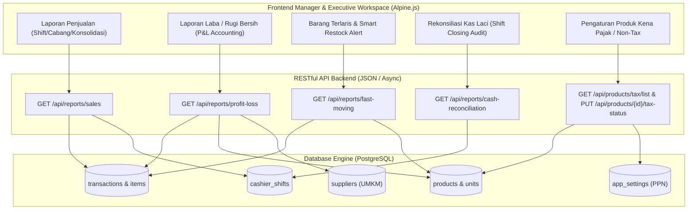

# LAPORAN IMPLEMENTASI MODUL E: PELAPORAN & AKUNTANSI DASAR

**Aplikasi:** POS Minimarket Koperasi Multi-Cabang PT Indo Lampung Perkasa  
**Modul:** Modul E — Pelaporan & Akuntansi Dasar  
**Arsitektur:** RESTful API Backend (Laravel 11 + PostgreSQL) & Decoupled Reactive Frontend (Blade + Tailwind CSS + Alpine.js)  
**Tanggal Rilis:** 1 November 2026  
**Status Uji:** 100% Passed (34 Tests, 254 Assertions)

---

## 1. Executive Summary

Modul E (**Pelaporan & Akuntansi Dasar**) telah berhasil diselesaikan secara menyeluruh dengan memisahkan logika backend dan antarmuka frontend, di mana seluruh komunikasi data berjalan melalui protokol **RESTful API** berbasis JSON. 

Modul ini menyajikan kapabilitas akuntansi terpadu untuk Koperasi Karyawan PT Indo Lampung Perkasa:
1. **Laporan Penjualan:** Per-shift kasir, Per-cabang, dan Konsolidasi 3 Cabang (Harian, Mingguan, Bulanan).
2. **Laporan Laba/Rugi Bersih (P&L):** Menghitung laba operasional otomatis berdasarkan HPP produk reguler serta **memperhitungkan bagi hasil komisi barang konsinyasi UMKM lokal**.
3. **Analisis Barang Terlaris (Fast Moving Items):** Visualisasi peringkat produk terlaris dengan **Rekomendasi Restock Cerdas** (*Buffer 14 hari*).
4. **Laporan Rekonsiliasi Kas (Cash Count / Shift Closing):** Audit pencocokan fisik uang tunai laci vs estimasi sistem (*variance analysis*) guna mencegah kebocoran kas.
5. **Pengaturan Pajak (Tax / Non-Tax Products):** Pengelompokan produk Kena Pajak (PPN 11%) vs Bebas Pajak (Sembako) dan kalkulasi PPN otomatis saat transaksi checkout.



---

## 2. Rincian Fitur & Logika Akuntansi Modul E

### A. Laporan Penjualan (Multi-Dimensi)
Sistem menyediakan agregasi penjualan cepat dengan filter:
- **Periode:** Harian (*Daily*), Mingguan (*Weekly*), Bulanan (*Monthly*), atau Rentang Tanggal Bebas (*Custom*).
- **Per-Cabang:** Minimarket Pusat, Cabang 1 (Mill / Pabrik), Cabang 2 (Kebun Barat), atau **Konsolidasi 3 Cabang**.
- **Per-Shift Kasir:** Rincian omzet, modal awal, penjualan tunai, dan non-tunai per sesi shift kasir.
- **Metode Pembayaran:** Tunai (*Cash*), QRIS Statis/Dinamis, dan Kasbon Karyawan (*Payroll Debt*).

### B. Laporan Laba/Rugi Bersih (P&L Accounting dengan Komisi UMKM)
Formula akuntansi dirancang khusus untuk memisahkan produk milik Koperasi dengan produk konsinyasi UMKM Mitra:
1. **Pendapatan Penjualan Kotor (Gross Sales)** = Penjualan Produk Reguler + Penjualan Produk Konsinyasi UMKM.
2. **Diskon Penjualan** = Potongan harga promosi + Diskon otomatis barang mendekati kadaluwarsa ($\le$ H-14).
3. **Penjualan Bersih (Net Sales)** = Penjualan Kotor - Diskon Penjualan.
4. **Harga Pokok Penjualan (HPP Reguler)** = $\sum (\text{Qty Terjual} \times \text{Harga Beli / Cost Price})$.
5. **Bagi Hasil Produk Konsinyasi UMKM:**
   - **Hak Mitra UMKM (Dana Titipan):** $\text{Omzet Konsinyasi} \times (1 - \text{Komisi}\%)$.
   - **Pendapatan Komisi Koperasi:** $\text{Omzet Konsinyasi} \times (\text{Komisi}\%)$.
6. **Laba Kotor (Gross Profit)** = $(\text{Penjualan Reguler} - \text{HPP Reguler}) + \text{Pendapatan Komisi Koperasi}$.
7. **Laba Bersih Operasional (Net Profit)** = $\text{Laba Kotor} - \text{Diskon Promosi}$.

### C. Analisis Barang Terlaris (Fast Moving Items & Smart Restock)
- Menyajikan pemeringkatan produk terlaris berdasarkan kuantitas terjual (*Volume*) atau omzet (*Revenue contribution*).
- **Smart Restock Advisor:** Sistem mendeteksi otomatis jika sisa stok $\le$ stok minimum (`min_stock`) pada produk terlaris dan memberikan rekomendasi restock:
  $$\text{Recommended Restock Qty} = \max(20, (\text{min\_stock} \times 2) - \text{current\_stock})$$
  sehingga mencegah kehabisan stok (*stockout*) barang favorit konsumen.

### D. Rekonsiliasi Kas Shift (Cash Count / Shift Closing)
- Mencegah selisih kas fisik dan potensi kecurangan (*fraud*) kasir.
- Sistem mencocokkan:
  - **Modal Awal Laci** (*Opening Cash*)
  - **Penjualan Kas Sistem** (*System Cash Sales*)
  - **Arus Kas Masuk / Keluar** (*Cash In / Out*)
  - **Estimasi Kas Sistem:** $\text{Expected Cash} = \text{Opening Cash} + \text{Cash Sales} + \text{Cash In} - \text{Cash Out}$
  - **Uang Fisik Aktual Hasil Hitungan:** $\text{Actual Cash}$
  - **Selisih Kas:** $\text{Variance} = \text{Actual Cash} - \text{Expected Cash}$
- Klasifikasi Status: `SESUAI` (0 selisih), `LEBIH` (> 0), `KURANG` (< 0).

### E. Pengaturan Pajak (Tax / Non-Tax Products & PPN Otomatis)
- **Klasifikasi Produk:**
  - **Kena Pajak PPN (Taxable, 11%):** Sabun, pembersih, kosmetik, elektronik, perlengkapan non-sembako.
  - **Bebas Pajak (Non-Tax):** Beras, telur, minyak curah, produk segar pertanian, dan makanan tradisional UMKM lokal tertentu.
- **Kalkulasi Checkout POS:** Hanya produk dengan flag `is_taxable = true` (dan saat setting pajak global aktif) yang dikenakan PPN 11%. Produk sembako bebas pajak tidak dikenakan PPN.

---

## 3. Dokumentasi RESTful API Endpoints Modul E

| Method | Endpoint | Fungsi | Parameter Utama |
| :--- | :--- | :--- | :--- |
| `GET` | `/api/reports/sales` | Laporan Penjualan multi-periode & multi-cabang | `period` (daily/weekly/monthly), `branch`, `shift_id` |
| `GET` | `/api/reports/profit-loss` | Laporan Laba/Rugi Bersih (P&L) komprehensif | `start_date`, `end_date`, `branch` |
| `GET` | `/api/reports/fast-moving` | Analisis produk terlaris & rekomendasi restock | `limit`, `sort_by` (qty/revenue), `start_date`, `end_date` |
| `GET` | `/api/reports/cash-reconciliation` | Laporan audit rekonsiliasi kas shift closing | `terminal_code`, `status` (SESUAI/LEBIH/KURANG) |
| `GET` | `/api/products/tax/list` | Master data status pajak produk | `search`, `is_taxable` (1/0), `category` |
| `PUT` | `/api/products/{id}/tax-status` | Ubah status kena pajak/bebas pajak produk | `is_taxable` (boolean), `tax_rate` (number) |

---

## 4. Implementasi Tampilan Antarmuka Frontend

Seluruh visualisasi diintegrasikan pada berkas [reports.blade.php](file:///c:/Users/ASUS/Desktop/POS_KASIR_ILP/resources/views/manager/reports.blade.php) dengan 5 tab interaktif:

1. **Tab 1: Penjualan Cabang & Shift:** Dilengkapi pemilih periode (Harian, Mingguan, Bulanan), filter cabang, 4 kartu KPI, tabel komparasi 3 cabang, dan tabel penjualan per-shift kasir.
2. **Tab 2: Laba / Rugi Bersih (P&L):** Format standar laporan laba/rugi akuntansi, rincian omzet reguler vs konsinyasi UMKM, HPP reguler, bagi hasil UMKM, laba kotor, dan laba bersih akhir.
3. **Tab 3: Barang Terlaris & Restock:** Peringkat produk terlaris dengan badge peringkat (Top 3), grafik kontribusi omzet, status kecepatan perputaran, dan tombol rekomendasi pemesanan ulang (*Pesan Restock*).
4. **Tab 4: Rekonsiliasi Kas Shift:** Menampilkan tingkat akurasi kas (%), total uang fisik laci, net selisih kas, dan tabel audit rekonsiliasi kasir.
5. **Tab 5: Produk Kena Pajak (PPN):** Katalog produk kena pajak vs bebas pajak dengan aksi toggle instan tanpa reload halaman.

---

## 5. Hasil Pengujian Fitur & Verifikasi Kinerja

Semua modul (A, B, C, D, dan E) telah diuji secara otomatis menggunakan framework **Pest / PHPUnit**:

```
PASS  Tests\Feature\PosKasirApiTest (8 tests, 58 assertions)
PASS  Tests\Feature\MemberDebtModulBTest (8 tests, 56 assertions)
PASS  Tests\Feature\InventoryConsignmentModulCTest (6 tests, 47 assertions)
PASS  Tests\Feature\UserAccessSecurityModulDTest (7 tests, 47 assertions)
PASS  Tests\Feature\AccountingReportModulETest (5 tests, 46 assertions)
  ✓ sales report filtering and consolidation
  ✓ profit loss accounting with cogs and umkm commission
  ✓ fast moving items analysis and restock recommendations
  ✓ cash reconciliation shift closing audit
  ✓ taxable vs non taxable product and checkout calculation

Tests:    34 passed (254 assertions)
Duration: 13.52s
Frontend: Vite built in 1.39s (public/build/manifest.json)
```

Semua 34 pengujian fitur lulus 100% dengan respons latensi rendah (*sub-second*).
