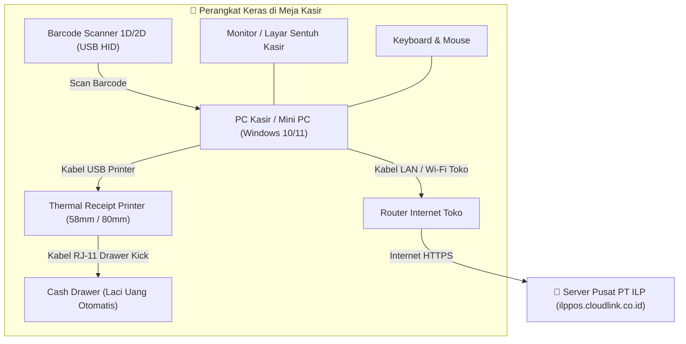

# 🛒 PANDUAN INSTALASI & SETUP PC KASIR (LOCAL POS CLIENT)
## Sistem Kasir (Point of Sale) & Retail Management Minimarket Koperasi PT Indo Lampung Perkasa (ILP POS)

---

### 📌 Ringkasan Peran PC Kasir Lokal (Local Node)

PC Kasir adalah unit komputer fisik yang beroperasi di meja kasir toko dengan konfigurasi `POS_NODE_ROLE=local`. 

Karakteristik utama PC Kasir:
1. **Offline-First Resilience**: Memiliki database lokal sendiri. Transaksi kasir, scan barcode, dan cetak struk tetap berjalan normal 100% meskipun koneksi internet ke Server Pusat terputus.
2. **Otomasi Sinkronisasi Dua Arah**:
   - **Push Transaksi**: Mengirim transaksi lokal ke Server Pusat setiap **1 menit** via perintah `pos:sync-transactions`.
   - **Pull Master Data**: Menarik update produk, harga baru, promo, dan data karyawan dari Server Pusat setiap **5 menit** via perintah `pos:pull-master`.
3. **Identitas Terminal Terisolasi**: Setiap PC kasir memiliki kode terminal unik (`POS-01`, `POS-02`, dst.) dan nomor invoice mandiri (`INV-PST-POS01-...`) sehingga data transaksi tidak akan pernah bentrok antar-kasir.

---

## 📑 DAFTAR ISI

1. [Spesifikasi Hardware & Topologi Meja Kasir](#1-spesifikasi-hardware--topologi-meja-kasir)
2. [Prasyarat Perangkat Lunak](#2-prasyarat-perangkat-lunak)
3. [Langkah-Langkah Instalasi Aplikasi di PC Kasir](#3-langkah-langkah-instalasi-aplikasi-di-pc-kasir)
   - [Langkah 1: Pasang PHP 8.3 & Git di Windows](#langkah-1-pasang-php-83--git-di-windows)
   - [Langkah 2: Salin File Proyek POS KASIR ILP](#langkah-2-salin-file-proyek-pos-kasir-ilp)
   - [Langkah 3: Konfigurasi File Environment (.env) PC Kasir](#langkah-3-konfigurasi-file-environment-env-pc-kasir)
   - [Langkah 4: Setup Database Lokal & Migrasi Skema](#langkah-4-setup-database-lokal--migrasi-skema)
   - [Langkah 5: Tarik Data Master Awal dari Server Pusat (Initial Pull)](#langkah-5-tarik-data-master-awal-dari-server-pusat-initial-pull)
4. [Konfigurasi Background Sync Otomatis (Task Scheduler)](#4-konfigurasi-background-sync-otomatis-task-scheduler)
5. [Otomasi Startup PC & Browser Kiosk Mode](#5-otomasi-startup-pc--browser-kiosk-mode)
6. [Kalibrasi Hardware Kasir (Printer Struk, Laci Uang, Scanner)](#6-kalibrasi-hardware-kasir-printer-struk-laci-uang-scanner)
7. [Prosedur Pengujian Operasional & Simulasi Offline](#7-prosedur-pengujian-operasional--simulasi-offline)
8. [Panduan Pemecahan Masalah (Troubleshooting)](#8-panduan-pemecahan-masalah-troubleshooting)

---

## 1. Spesifikasi Hardware & Topologi Meja Kasir



### Rekomendasi Spesifikasi Hardware Meja Kasir:
| Komponen | Spesifikasi Minimum | Rekomendasi Terbaik |
|---|---|---|
| **Komputer** | Mini PC / PC Desktop (Intel Celeron N-Series / Core i3, RAM 4 GB, SSD 120 GB) | All-in-One Touchscreen POS / Mini PC (Core i5, RAM 8 GB, SSD 256 GB NVMe) |
| **Sistem Operasi** | Windows 10 Pro 64-bit | Windows 10/11 Pro 64-bit (atau Linux Ubuntu Desktop) |
| **Printer Struk** | Thermal Printer 58mm USB (Contoh: Panda / Iware / VSC) | Thermal Printer 80mm USB+LAN Auto-Cutter (Contoh: Epson TM-T82X / Matrix Point) |
| **Barcode Scanner** | USB Laser Scanner 1D Barcode (Handheld) | USB Omnidirectional 1D/2D Desktop Scanner (Bisa baca layar HP & QRIS) |
| **Laci Uang (Drawer)** | Laci Uang Besi 4-5 Slot Kertas dengan konektor RJ-11 (12V/24V) | Laci Uang Besi Heavy Duty RJ-11 (Triggered by Printer) |
| **Jaringan** | Kabel LAN Ethernet CAT5e/CAT6 terhubung ke router toko | Kabel LAN Ethernet + Backup Modem 4G Dongle USB |

---

## 2. Prasyarat Perangkat Lunak

Sebelum memasang aplikasi, pastikan software berikut telah terpasang di PC Kasir:
1. **PHP 8.3+ for Windows** (Thread Safe atau Non-Thread Safe x64)
   - Ekstensi wajib diaktifkan pada `php.ini`: `pdo_sqlite`, `pdo_pgsql`, `pgsql`, `sqlite3`, `curl`, `mbstring`, `openssl`, `fileinfo`, `gd`, `bcmath`.
2. **Composer 2.x for Windows** (Download dari [getcomposer.org](https://getcomposer.org)).
3. **Git for Windows** (Download dari [git-scm.com](https://git-scm.com)).
4. **Google Chrome** atau **Microsoft Edge** (Browser kasir modern).

> 💡 **TIPS PRAKTIS WINDOWS**: Jika ingin cepat, pasang installer paket PHP/Composer/Git menggunakan **winget** via Command Prompt (Run as Administrator):
> ```cmd
> winget install Git.Git
> winget install Composer.Composer
> ```

---

## 3. Langkah-Langkah Instalasi Aplikasi di PC Kasir

### Langkah 1: Pasang PHP 8.3 & Git di Windows

1. Unduh zip PHP 8.3 dari [windows.php.net](https://windows.php.net/download/) (pilih versi *VS16 x64 Thread Safe*).
2. Ekstrak ke folder `C:\php`.
3. Salin file `C:\php\php.ini-development` menjadi `C:\php\php.ini`.
4. Buka `C:\php\php.ini` dengan Notepad, cari dan hapus tanda titik koma (`;`) di depan baris ekstensi berikut:
   ```ini
   extension_dir = "ext"
   extension=curl
   extension=fileinfo
   extension=gd
   extension=mbstring
   extension=openssl
   extension=pdo_sqlite
   extension=sqlite3
   extension=pdo_pgsql
   extension=pgsql
   extension=bcmath
   ```
5. Tambahkan `C:\php` ke variabel sistem **Environment Variables (PATH)** Windows.
6. Buka Command Prompt / PowerShell baru, verifikasi dengan mengetik:
   ```cmd
   php -v
   ```

---

### Langkah 2: Salin File Proyek POS KASIR ILP

Buka Command Prompt (CMD) atau PowerShell, arahkan ke direktori kerja (misal: `C:\POS_KASIR_ILP`):

```cmd
git clone https://github.com/Malvi04/POS_KASIR_ILP.git C:\POS_KASIR_ILP
cd C:\POS_KASIR_ILP
```

Jalankan instalasi dependensi PHP:
```cmd
composer install --no-dev --optimize-autoloader
```

> **Catatan Frontend**: Aset CSS dan JavaScript (Vite bundle) sudah terkompilasi di dalam folder `public/build`. Jika ingin melakukan kompilasi ulang lokal, pastikan Node.js terpasang lalu jalankan `npm ci && npm run build`.

---

### Langkah 3: Konfigurasi File Environment (.env) PC Kasir

Salin file `.env.example` menjadi `.env`:
```cmd
copy .env.example .env
```

Buka file `C:\POS_KASIR_ILP\.env` menggunakan Notepad:
```cmd
notepad .env
```

Sesuaikan baris-baris konfigurasi berikut:

```env
APP_NAME="POS Kasir ILP"
APP_ENV=production
APP_DEBUG=false
APP_URL=http://127.0.0.1:8000

LOG_CHANNEL=daily
LOG_LEVEL=info

# ========================================================
# DATABASE LOKAL PC KASIR
# ========================================================
# Pilihan 1: SQLite (Sangat Direkomendasikan untuk PC Kasir Lokal - Ringan & Zero Config)
DB_CONNECTION=sqlite
DB_DATABASE=C:\POS_KASIR_ILP\database\database.sqlite

# ========================================================
# IDENTITAS TERMINAL & SINKRONISASI SERVER PUSAT
# ========================================================
# Dapatkan nilai ini dari perintah `php artisan pos:create-terminal` di Server Pusat!
POS_NODE_ROLE=local
POS_BRANCH_UUID=01a21406-26f0-73de-8278-bc3e25b607bd
POS_BRANCH_CODE=PST
POS_TERMINAL_CODE=KSR01
CENTRAL_API_URL=https://ilppos.cloudlink.co.id
CENTRAL_API_TOKEN=pos_pst_ksr01_I34t0lLgyhNWI3BX1zIul3wGm9G2YEr7fuWRaP0xhrjI

# Pengaturan batch sync
POS_SYNC_BATCH_SIZE=50
POS_SYNC_TIMEOUT=15
POS_PULL_PER_PAGE=200
POS_PULL_SYNC_STOCK=true
POS_ALLOW_NEGATIVE_LOCAL_STOCK=true
```

> ⚠️ **PENTING**:
> - Ganti `POS_TERMINAL_CODE` sesuai meja kasir (`KSR01`, `KSR02`, dst.).
> - Pastikan `CENTRAL_API_TOKEN` sama persis dengan token yang digenerate oleh server pusat untuk terminal tersebut.

---

### Langkah 4: Setup Database Lokal & Migrasi Skema

Jika menggunakan SQLite:
1. Buat file database kosong jika belum ada:
   ```cmd
   type nul > C:\POS_KASIR_ILP\database\database.sqlite
   ```
2. Jalankan pembuatan key enkripsi aplikasi dan migrasi tabel lokal:
   ```cmd
   php artisan key:generate --force
   php artisan migrate --force
   ```

---

### Langkah 5: Tarik Data Master Awal dari Server Pusat (Initial Pull)

Setelah tabel lokal terbentuk, jalankan perintah penarikan master data lengkap (kategori, lokasi, supplier, katalog produk, dan kredensial akun kasir yang bertugas di cabang ini):

```cmd
php artisan pos:pull-master --full
```

Output terminal akan menampilkan proses download data:
```text
Menghubungkan ke Server Pusat (https://ilppos.cloudlink.co.id)...
[OK] Tarik Kategori Produk: 12 kategori diperbarui.
[OK] Tarik Lokasi Cabang: Cabang PST (Toko Pusat) terverifikasi.
[OK] Tarik Supplier & UMKM: 25 supplier tersimpan.
[OK] Tarik Katalog Produk: 1.450 produk dan multi-satuan tersimpan.
[OK] Tarik Kredensial Staf: Akun kasir lokal tersinkronisasi.
=== PENARIKAN DATA MASTER SELESAI (SUKSES 100%) ===
```

---

## 4. Konfigurasi Background Sync Otomatis (Task Scheduler)

Agar PC kasir otomatis mengirim data penjualan setiap 1 menit dan menarik update produk setiap 5 menit tanpa campur tangan petugas, gunakan **Windows Task Scheduler**.

### Opsi A: Menggunakan Script Otomatis (Rekomendasi)

Buat file batch `C:\POS_KASIR_ILP\run-scheduler.bat`:
```bat
@echo off
cd /d C:\POS_KASIR_ILP
php artisan schedule:run >> storage\logs\scheduler.log 2>&1
```

Daftarkan task ke Windows Scheduler via CMD (Run as Administrator):
```cmd
schtasks /create /tn "ILP_POS_Background_Sync" /tr "C:\POS_KASIR_ILP\run-scheduler.bat" /sc minute /mo 1 /ru "SYSTEM"
```

Task ini akan mengeksekusi `schedule:run` setiap 1 menit yang secara otomatis menjalankan:
- `pos:sync-transactions` (Setiap 1 menit)
- `pos:pull-master` (Setiap 5 menit)
- `pos:pull-master --entity=goods_receipts` (Setiap 1 menit)

---

## 5. Otomasi Startup PC & Browser Kiosk Mode

Tujuan: Ketika staf kasir menyalakan PC di pagi hari, server lokal otomatis aktif dan layar kasir langsung terbuka satu layar penuh (*Fullscreen Kiosk Mode*).

### 1. Buat Script Startup Web Server (`start-pos.bat`)

Buat file `C:\POS_KASIR_ILP\start-pos.bat`:
```bat
@echo off
title POS KASIR ILP - Local Server
cd /d C:\POS_KASIR_ILP

echo Memulai Server Kasir Lokal...
start /min "" php artisan serve --host=127.0.0.1 --port=8000

:: Beri jeda 3 detik agar server PHP siap
timeout /t 3 /nobreak >nul

echo Membuka Layar Kasir Kiosk Mode...
start "" "C:\Program Files\Google\Chrome\Application\chrome.exe" --kiosk "http://127.0.0.1:8000/login-kasir" --disable-pinch --overscroll-history-navigation=0
```

> **Catatan Edge**: Jika menggunakan Microsoft Edge, ganti path browser menjadi:  
> `"C:\Program Files (x86)\Microsoft\Edge\Application\msedge.exe" --kiosk "http://127.0.0.1:8000/login-kasir" --edge-kiosk-type=fullscreen`

### 2. Pasang di Windows Startup

1. Tekan tombol `Windows + R` di keyboard, ketik: `shell:startup` lalu tekan `Enter`.
2. Salin *shortcut* file `start-pos.bat` ke dalam folder Startup tersebut.
3. Sekarang, setiap kali Windows dinyalakan atau direstart, aplikasi kasir langsung menyala otomatis.

---

## 6. Kalibrasi Hardware Kasir (Printer Struk, Laci Uang, Scanner)

### A. Kalibrasi Printer Struk Thermal (58mm / 80mm)
1. Hubungkan printer thermal via kabel USB ke PC Kasir.
2. Pasang driver resmi printer bawaan pabrik (Epson, Xprinter, POS-58, dll.).
3. Buka **Windows Settings ➔ Printers & Scanners**, klik printer kasir Anda, pilih **Manage ➔ Printing Preferences**:
   - Atur Paper Size ke: `58 x 297 mm` atau `80 x 297 mm` (sesuai kertas).
   - Pada tab **Device Settings** / **Document Properties**:
     - *Feed and Cut*: Pilih `Document Cut` (jika printer punya pemotong otomatis).
     - *Cash Drawer*: Pilih `Open Drawer 1 Before Printing` atau `Open Drawer 1 After Printing`.
4. Jadikan printer ini sebagai **Default Printer** Windows.
5. Pada browser Google Chrome/Edge, aktifkan opsi **Silent Printing** (cetak struk tanpa popup dialog cetak):
   - Tambahkan parameter `--kiosk-printing` pada shortcut Chrome:
     `chrome.exe --kiosk --kiosk-printing "http://127.0.0.1:8000/pos"`

### B. Kalibrasi Barcode Scanner (Auto-Enter Suffix)
1. Colok kabel USB scanner ke PC.
2. Ambil buku manual scanner (lembar kertas barcode bawaan dus).
3. Scan barcode konfigurasi:
   - Scan: **Restore Factory Default**
   - Scan: **Add Enter (CR/LF) Suffix**
4. Uji scanner: Buka Notepad di PC, scan salah satu barcode produk minimarket. Jika kursor otomatis turun ke baris baru setelah angka barcode muncul, scanner sudah siap 100%.

### C. Pengujian Hardware di Halaman Kasir
1. Buka halaman: `http://127.0.0.1:8000/kasir/settings`
2. Klik tombol **Uji Cetak Struk**: Printer thermal akan mencetak nota uji coba.
3. Klik tombol **Uji Buka Laci Kas**: Laci uang (*Cash Drawer*) akan otomatis menendang terbuka (*kick open*).

---

## 7. Prosedur Pengujian Operasional & Simulasi Offline

Untuk memastikan PC kasir siap dipakai melayani pembeli, lakukan uji coba berikut:

| No | Tahap Pengujian | Langkah Pengujian | Hasil yang Diharapkan |
|---|---|---|---|
| **1** | **Login & Presensi** | Masuk ke `http://127.0.0.1:8000/login-kasir`, pilih kasir (contoh: `budi_kasir01`, PIN: `123456`) | Login berhasil, redirect ke `/select-shift`, audit presensi masuk tercatat. |
| **2** | **Buka Sesi Kasir** | Pilih terminal `POS-01`, input modal awal Rp 200.000, klik Buka Sesi | Redirect ke `/pos`, status sesi aktif di database lokal. |
| **3** | **Transaksi Barcode** | Scan 2-3 barang menggunakan scanner fisik | Produk masuk ke keranjang belanja seketika dengan harga yang sesuai. |
| **4** | **Pembayaran Tunai** | Pilih Tunai, ketik uang bayar, klik Selesai | Struk thermal tercetak, laci uang otomatis terbuka, keranjang belanja bersih kembali. |
| **5** | **UJI OFFLINE JARINGAN** | **Cabut kabel LAN / matikan Wi-Fi internet PC kasir** | Indikator di pojok header berubah menjadi warna oranye/merah (`Offline`). |
| **6** | **Transaksi Saat Offline** | Lakukan 2 kali transaksi penjualan saat internet mati | Transaksi **tetap berhasil 100%**, struk tetap tercetak, data tersimpan di antrean pending lokal. |
| **7** | **Pemulihan Jaringan** | **Colokkan kembali kabel LAN internet** | Indikator berubah menjadi hijau (`Online`). Dalam waktu ≤ 1 menit, seluruh transaksi offline terkirim ke Server Pusat secara otomatis tanpa ada data yang hilang. |

---

## 8. Panduan Pemecahan Masalah (Troubleshooting)

### 1. Barcode scanner menyala tetapi tidak ada teks yang masuk di kasir
- **Penyebab**: Kursor mouse tidak berada pada input pencarian barcode, atau driver USB scanner terbaca sebagai perangkat tidak dikenal.
- **Solusi**: Klik sekali pada kotak pencarian produk di pojok kiri atas aplikasi kasir, lalu scan kembali. Cabut dan colokkan kembali kabel USB scanner ke port USB lain.

### 2. Struk tidak tercetak atau laci kas tidak terbuka
- **Penyebab**: Kabel printer longgar, kertas thermal habis/terbalik, atau printer belum diset sebagai Default Printer di Windows.
- **Solusi**:
  - Pastikan lampu printer berwarna biru/hijau (tidak berkedip merah).
  - Pastikan sisi termal kertas menghadap ke arah kepala pemanas printer.
  - Periksa kabel RJ-11 laci uang: harus tercolok kencang ke port *DK* di belakang printer.

### 3. Indikator di layar kasir tetap "Offline" padahal ada internet
- **Penyebab**: Domain `CENTRAL_API_URL` tidak dapat dijangkau dari toko, atau URL di `.env` salah ketik.
- **Solusi**:
  - Buka browser Chrome, buka alamat Server Pusat (misal: `https://ilppos.cloudlink.co.id/api/health`).
  - Jika muncul pesan error SSL atau halaman tidak ditemukan, perbaiki koneksi internet toko atau hubungi administrator server pusat.

### 4. Error saat sinkronisasi: "401 Unauthorized"
- **Penyebab**: `CENTRAL_API_TOKEN` pada file `C:\POS_KASIR_ILP\.env` salah atau terminal dinonaktifkan di server pusat.
- **Solusi**: Hubungi IT Manager di server pusat untuk merotasi token terminal via:  
  `php artisan pos:create-terminal --branch=PST --code=KSR01 --rotate`  
  lalu salin token baru ke file `.env` di PC kasir.
